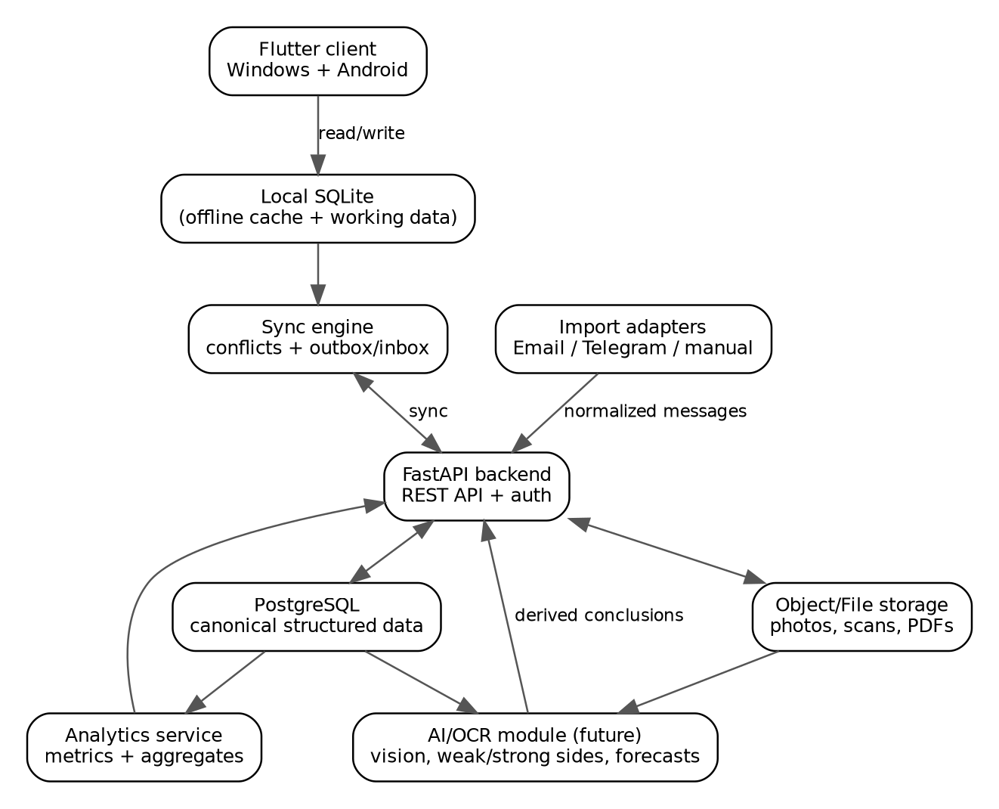

# Архитектура Studium

## Исправления review PR #3 — v11

`0011_qa_review_fixes` добавляет immutable PlanContentSource и
LateWorkAuthorization. Первая поздняя сдача создаёт StudentWork при доказанном
завершённом участии в исходной выданной работе; scoped authorization и deferred
FK фиксируются с Attempt/Submission/files одной транзакцией. ACTIVE guard для
прочих записей, deleted context и membership identity сохраняются.

QAContentSources фиксирует нужные source snapshots, точные links, family/variant
revisions и файлы. Выдача и последующее назначение студенту читают сохранённое
содержание. Переназначение плана использует pure preview, fingerprint всех
затронутых assignments/facts и подтверждённый atomic apply; прежние bindings
остаются immutable. QASummary считает distinct works по общему resolver,
substantive review и current typed deadline. [ADR-051](decisions.md#adr-051).

## Текущий пакет QA — 0.2.0

QAPackageService дополняет application facade через concrete repository/UoW ports;
`domain/qa.py` содержит exact score/deadline/result правила без Qt/SQL.
`0010_qa_package` использует frozen static DDL и deterministic UUID backfill,
исторические миграции неизменны. Immutable версия CourseProgram отделена от
SemesterPlan конкретной группы/периода; content/ordinal выбираются явно.
PlanHistory хранит original/current snapshots. Submission/Review/ReviewGrade/
ReviewFile/ReviewReturn разделяют реальные события, timestamps и immutable files.
RequiredWorkSet/DebtRestoration сохраняют индивидуальные долги. Journal, analytics
и reporting используют общий evidence-aware resolver и fixed bulk reads.
Read-only формы/DTO не создают фактов.

`qa_plans.py`, `qa_workflow.py`, `qa_content.py` используют прежний router,
FormDialog/tokens/Studium generator. StagedAttachmentPicker общий для content,
submission и review; metadata/links/file batch фиксируются одной транзакцией.
IO/preview вне GUI-thread, delivery/stale guards внутри него. Python cyclic GC
Qt wrappers выполняется application-owned GUI timer. Teacher snapshots разделены
с student DTO/export whitelist. [ADR-050](decisions.md#adr-050--qa-all-30-implementation).
Ниже сохранены описания предыдущих фаз, не текущий schema head.

> Документ относится к Studium как независимому локальному приложению.
> Bender — отдельный проект; будущая интеграция использует локальный JSON-RPC
> 2.0 over stdio. Прямые импорты Bender, API/client, облачный сервер и новые
> возможности этим переносом не реализованы. Описания прежних фаз сохраняют
> технические требования; их проверки и acceptance не подтверждены этим текстом.

[Управленческая сводка](management/PROJECT_STATUS.md) отделяет текущую
реализацию от фазовых описаний ниже. После Iteration 4 влиты
[Reporting & Export](iteration5a-reporting.md) (#8),
[Backup & Recovery](iteration5b-backup-recovery.md) (#10) и
[Windows installer](windows-beta-distribution.md) (#11).
Их подробные контракты остаются в указанных документах. Bender ещё в открытых
PR и в `main` отсутствует. Утверждения «не реализуется» в разделах прежних
фаз относятся к границе той фазы, а server/sync/mobile/AI остаются будущими.

## Iteration 4 — локальная сохранность и Help

Границы domain/application/infrastructure/presentation прежние. DeletionService
в application вычисляет последствия и использует repository soft-delete,
не выполняет destructive cascades. StudentWorkFacts — immutable read DTO из
прежнего analytics snapshot; UI не получает ORM и не записывает факты при чтении.
SeminarProblem/ProgramModuleTopic — concrete FK links через прежние repositories
и transaction policy. Detail preview переиспользует bounded Qt image/PDF flow
и generation guards. Файлы импортируются в прежний managed storage; исправление
общего Library Open локально в ContentEditor, path access остаётся через сервис.

Help — packaged local Markdown/JSON resources, QTextBrowser и локальный поиск.
open_help(article_id) работает через MainWindow router; сети/web engine нет.
JsonPreferences хранит table widths отдельно от учебной БД. DOC rebuild — явно
разрешённое исключение ADR-045; transaction/FK enforcement не отключаются.
Новых runtime dependencies и внешних integration boundaries нет.

## Iteration 2 — текущая архитектура

Course → WorkProgram → CourseOffering → Journal — основной локальный workflow.
ProgramService, JournalService и ProgressChartsService дополняют application
фасад; UI получает domain entities и immutable DTO, без ORM Session. Reusable
WorkDefinition (alias HomeworkDefinition) связывается с программами через
ProgramWork; Assessment остаётся конкретной выдачей группе. ProgramModule,
calendar и scope проверяются application и SQLite constraints/triggers.

Additive Alembic `0007_work_programs` выполняет frozen SQL и transactional
backfill v6; исторические v1–v6 неизменны. 77 user tables. Новые конкретные FK
для программ, knowledge, shared packs, bank tasks и skill results используют
прежние repository/UoW и FileAsset/storage ports. Assignment text/teacher/files
фиксируются при выдаче; StudentProblemFile сохраняет ссылку на immutable bytes.

Journal строится bulk reads (23 SELECT на synthetic 30 × 17 + 6), не запросами
по каждой ячейке. Progress DTO использует один snapshot (24 SELECT); недельные
cutoffs вычисляются в памяти. Radial radius и weekly line показывают одну долю
зачтённых назначенных работ. Отмена занятия исключает attendance из аналитики;
плановая дата/неделя при переносе сохраняются. as_of — известные текущие факты,
не audit старых редакций. Theme/recent contexts — локальный preferences.json.

Windows onedir packaging и системный Python сохранены; новых dependencies нет.
Проверки используют только temporary synthetic roots. [Отчёт](iteration2-review.md),
ADR-039–041. Server/sync/mobile/AI/live adapters остаются отложенными.

## Phase 6.6 — историческая архитектура Iteration 1

WorkflowAnalyticsService дополняют StudiumService через domain repository
contracts и Repositories/UoW. UI не получает ORM/Session; domain чистый.
NavigationStack/Sidebar управляют внутренними страницами, LibraryPage содержит
четыре библиотеки. FileDropZone передаёт paths прежним application imports;
IO/генерация — BackgroundCall. Preview Phase 4 переиспользуется.
Ticket snapshots с explicit FileAsset FK сохраняют историческое содержание.
QtCharts отображает FACT-derived DTO. Alembic v6 выполняет статический SQL
snapshot, без create_all и изменения v1–v5. Freeze Phase 6.5 ниже — исторический.
Server/sync/mobile/AI/live adapters отложены, отдельное задание обязательно.


## Windows workspace и packaging Phase 6.5

Domain и production schema остаются Phase 6 (`0005_analytics_foundation`, 31 user tables). Новые presentation modules `theme`, `widgets`, `quick_attempt`, `background` отвечают за оформление, Qt tables/shortcuts, компактный ввод и worker IO. Существующие pages/dialogs используют application DTO/contracts; ORM Session в UI не передаётся. Application добавляет фасад записи Attempt, raw Lesson list counts, bulk attendance transaction и recent activity DTO; формулы аналитики не меняются. Queries attendance и Question context используют bulk reads.

File workers выполняют application calls через прежние transaction/file ports; GUI получает queued signal, QPixmap/QtPDF widgets создаются в GUI thread. Generation/current-selection guards отбрасывают старые ответы; при завершении приложения QThreadPool заканчивает работу до закрытия runtime. Список файлов карточки загружается только при открытии вкладки. Аналитика остаётся synchronous read: synthetic 30 × 20 укладывается примерно в 0.1 s/22 SELECT; она запускается при открытии активной вкладки, без нового cache/source of truth.

`Studium.spec` и `scripts/build_windows.ps1` собирают GUI onedir executable; build dependencies отделены в `requirements-build.lock`. Alembic Python/SQL resources находятся физически внутри `_internal`, Qt Windows/image/PDF plugins включены штатными hooks. PATH сборки ограничен Python/System32, предотвращая захват чужих ICU DLL. `%LOCALAPPDATA%\Studium` остаётся normal data root; bundle не хранит пользовательские данные. ADR-033/034 и [проверки](phase65-review.md).


## Локальное приложение Phase 1R–6

Основные данные сохраняются локально; сервер и AI не нужны. Domain — frozen dataclasses, enums, EntityId/UUID, UtcInstant и LocalDate. Application содержит StudiumService, domain repository Protocol, transaction boundary и immutable query DTO. Infrastructure реализует ORM mapping, транзакции, constraints и миграции. Presentation реализует PySide6 MainWindow, локальные разделы, формы и read-only Model/View. Composition root `src/studium/composition.py` подключает adapters до передачи service/Diagnostics в MainWindow.

| Слой | Расположение | Зависимости и обязанности |
|---|---|---|
| Domain | `src/studium/domain` | Только Python standard library; сущности, invariants, StudentWorkProgress, repository ports |
| Application | `src/studium/application` | Domain; StudiumService, Repositories/Transaction/Preferences ports, query DTO; без Qt/ORM Session |
| Infrastructure | `src/studium/infrastructure` | Domain/application ports + SQLAlchemy/Alembic; mapping, короткие транзакции, compare-and-swap revision |
| Presentation | `src/studium/presentation/desktop` | PySide6; application services и domain values, без SQL/Session/ORM models |

Зависимости направлены к domain. AST test контролирует imports слоёв. Общего UI с Android нет: мобильный клиент выделен в будущую Phase 9. Phase 4 добавляет file storage/preview adapters; Phase 5 — локальные communications. Sync и AI не реализованы.

## Системный Python и зависимости

Проверен Python 3.12.10 x64 из пользовательской системной установки, SQLite 3.49.1. `.venv` создан этим interpreter; embedded Codex runtime не используется. PySide6 6.11.2, SQLAlchemy 2.1.1, Alembic 1.20.0; pytest 9.1.1, pytest-cov 7.1.0, Ruff 0.16.9. Версии выбраны по stable PyPI metadata и проверены реальной установкой. Прямые зависимости находятся в pyproject, полная dev-среда — в requirements-dev.lock. Pydantic не нужен текущим контрактам.

## Production database v1 и additive v2/v3/v4/v5

Десять таблиц управляются Alembic revision `0001_local_core`; SQL snapshot входит в устанавливаемый пакет. ORM metadata содержит те же columns, checks, FK, unique/indexes; triggers входят в версионированную SQL-миграцию. `create_all` в production и тестах не используется. Upgrade вызывается composition root при каждом запуске до MainWindow; scripts/migrate.py остаётся admin/development-инструментом. Обычная папка — `%LOCALAPPDATA%/Studium`, отдельный dev/test путь задаётся `--data-dir` или temporary runtime. Путь централизован в infrastructure/user_data.py, preferences.json хранит только выбранный term UUID. Schema v1 в Phase 2 не изменена.

Connection policy включает `foreign_keys=ON` на каждом соединении до BEGIN, busy_timeout=5000 и Python sqlite3 `autocommit=False` для настоящих транзакций, включая DDL. Для локального desktop file database включён WAL: читатели могут продолжать работу при короткой записи, что полезно будущим экранам и фоновым локальным операциям. SQLite остаётся с одним writer; network/shared file storage не предполагается. Синхронность SQLite по умолчанию не ослабляется. WAL можно явно отключить через `wal=False`; backup/доступ к реальным данным требуют отдельного решения OPEN-011.

Каждая mutation repository — короткая транзакция. Attempt + optional Grade записываются атомарно; ошибка Grade откатывает Attempt. Обновление требует expected_revision, SQL UPDATE проверяет прежнюю revision. Storage exceptions переводятся в domain RepositoryError без SQL parameters/персональных данных. Результат StudentWork вычисляется одним чтением согласованной истории, отдельного status cache в таблице нет.

Непустая БД без Alembic version отвергается; unknown future revision также не вызывает reset. Повторный upgrade идемпотентен. Revision `0002_learning_model`, down_revision `0001_local_core`, добавляет 11 таблиц без ALTER исторического ядра. Проверено сохранение всех строк десяти таблиц и их DDL/indexes/triggers на копии синтетической populated Phase 2 DB, fresh install и повторный reopen. Downgrade с удалением учебных фактов запрещён. Для будущих SQLite batch migrations нужно явно сохранять checks/triggers/indexes и проверять foreign_key_check; autogeneration не заменяет ручной review triggers.

## Учебная модель Phase 3

StudiumService дополняется LearningService: справочник Topic/Skill дисциплины, фактические Lesson и Attendance, AssessmentItem и шесть нормализованных типов связей. Используются прежние repository Protocol, UoW и immutable domain/DTO; Phase 3 не вводила REST/analytics boundary. Phase 6 ниже добавляет отдельный локальный analytics layer. Новые зависимости не требуются. ORM Base вынесен в models/base.py для общего metadata v1/v2.

Каталог Course → Topic/Skill описывает содержание, не факт прохождения. Lesson → Topic — явный факт преподавателя; Lesson относится к CourseOffering. Assessment/AssessmentItem → Topic/Skill обозначает проверяемое содержание. TopicSkill не означает автоматически, что каждый навык отрабатывался на каждом занятии по теме. Связи всей работы и частей независимы, автоматического наследования/суммирования нет.

UUID/revisions/UTC metadata распространяются на все 11 новых таблиц, включая связи. FK RESTRICT, UNIQUE пар, reverse indexes и triggers защищают контекст дисциплины, cycles, identity и metadata. Архивирование темы выполняет soft delete всего поддерева атомарно; ранее записанные связи остаются доступны с архивной темой. Detach — soft delete связи, повторный attach восстанавливает тот же UUID и повышает revision. Это текущие изменяемые mappings с tombstone, не полная audit-история всех периодов активности; см. OPEN-014/011.

Редактирование Lesson вместе с темами и замена содержимого Assessment/Item атомарны. UI передаёт snapshot связей; внешнее изменение вызывает REVISION_CONFLICT. Перестановка Items передаёт полный ordered snapshot с revisions, stale edit откатывает весь reorder. Attendance использует explicit Enrollment того же offering, UNIQUE пары и дополнительную защиту от двух отметок одному Student на одном Lesson после повторного зачисления. Ранее завершённый Enrollment и его отметка не исчезают.

Lesson.lesson_date — LocalDate без преобразования в UTC. Она не устанавливает точный момент занятия. Проверка временного пересечения с Enrollment не придумывается: преподаватель явно выбирает интервал участия; границы по календарным дням и учебный timezone остаются OPEN-009. UI показывает все сохранённые интервалы; отсутствие отметки отличается от UNKNOWN. Полноценный attendance subsystem, syllabus, файлы, результаты задач и analytics не реализуются в Phase 3.

Исходная схема architecture.png ниже — историческая иллюстрация ТЗ v0.1; актуальные слои и стек определены этим текстом и ADR-014.



## История и данные

В ядре v1 `StudentWork` хранит идентичность работы студента, а `StudentWorkProgress` вычисляет состояние из истории `Attempt` по attempt_no. Новая переделка добавляет запись. Столбцов status/final_score в StudentWork нет. Коррекция первичных фактов требует нового предъявления; metadata soft delete сохраняет прежнюю запись. Полная политика исправлений/audit остаётся открытой.

Phase 2 services атомарно создают Student + Enrollment через общий unit of work. Существующие автономные repository transactions сохранены. Matrix query читает согласованный snapshot и загружает данные пакетами, не по ячейке; 25 × 30 проверены при не более 10 SELECT. Read transactions закрываются перед append: attempt_no = max всей истории, включая soft delete, + 1. UNIQUE/monotonic trigger разрешают гонку; конфликтующий writer перечитывает историю, максимум 5 попыток. Attempt + optional Grade остаются одним commit. Это локальная конкуренция, не решение sync conflicts.

UUID создаются независимо от будущего сервера. Временные метки хранятся в UTC, локальное время показывается пользователю. Изменяемым данным нужны timestamps, version/revision и при необходимости deleted_at; формат и область ревизий определяются до соответствующих миграций. AcademicTerm использует LocalDate без timezone conversion. Phase 2 отображает абсолютные даты/время в текущем поясе Windows и преобразует ввод обратно в UTC. Пояс учебного контекста, date-only deadline и дни просрочки остаются OPEN-009. Пустая дата выдачи означает время создания, при редактировании — сохранение прежнего issued_at.

Доступ к учебным данным проходит через репозитории, доступ к файлам — через `AttachmentService`. Локальные операции со связанными структурными записями транзакционны. Запись файлов и БД использует компенсацию/журнал Phase 4 (ADR-024); полная backup/recovery policy остаётся OPEN-011.

## Вложения

Phase 4 уточняет обобщённый Attachment исходного ТЗ как **FileAsset + AttemptAttachment** (ADR-023–ADR-026). SQLite хранит только metadata, relative key, SHA-256/size и FK-связь с Attempt. Asset UUID не зависит от source path, содержимое immutable; новая версия — новый asset. Исходный source не меняется. Нет owner_type/owner_id, BLOB, CAS/dedup или преждевременного MessageAttachment.

Пример §12 (`storage/owner/term/offering/student/attempts/...`) остаётся иллюстрацией. Production root — `%LOCALAPPDATA%\Studium`:

```text
Studium/
├── studium.sqlite (+ SQLite WAL/SHM при работе)
├── preferences.json
├── files/
│   ├── <UUID prefix>/<UUID>.<extension>   # immutable read-only originals
│   └── .imports/                        # bounded transaction journal
│       ├── lock                         # OS cross-process lock
│       ├── <UUID>.json                   # pending storage key
│       └── <UUID>.tmp                    # staged bytes, пока идёт copy
└── cache/thumbnails/
    └── <UUID>-<SHA256>-<size>-v1.png      # regeneratable 240/1400 px cache
```

Source basename — только metadata; controlled relative UUID key проверяется domain/SQL/adapter. Storage symlinks/junctions, traversal и executable/script/shortcut types отвергаются. Принимается allowlist обычных документов/изображений/архивов, BIN хранится без системного открытия; MIME extension map не зависит от Windows registry. Максимум 1 GiB/import и 50 млн image pixels/preview. Это локальная валидация, не OCR/антивирус. QDesktopServices передаёт controlled local URL default application, без shell string. Read-only attribute защищает от случайной правки в viewer; integrity проверяет также внешние изменения.

AttachmentService через FileStorage/FileOpener/ThumbnailCache ports импортирует, проверяет, открывает и возвращает frozen FileEntry. Repository/UoW используют две новые таблицы revision **0003_attachments** после v2, без изменения исторических migrations. В query контекст получается Student → Work → Attempt → Attachment; archived academic parents не теряют файлы. UI не получает ORM. Модули `infrastructure/file_storage.py` и `file_preview.py` подключаются composition root.

Импорт: validate → fsynced marker/temp copy с SHA-256 → atomic no-overwrite publication → DB transaction FileAsset+link → cleanup journal. Failure DB удаляет новый uncommitted original; failure filesystem не пишет фиктивную DB row. Pending cleanup даёт явное сообщение. Startup под тем же OS lock сверяет **только** journal entries с DB, включая archived assets: committed bytes сохраняет, uncommitted bytes/temp убирает. Повреждённый marker сохраняется и блокирует запуск до исправления; чужие/unlinked originals не обходятся GC. Проверены реальные process crashes до и после commit. Это import reconciliation, не backup/restore subsystem (OPEN-011).

Integrity — derived available/missing/corrupted по размеру/SHA-256, без mutation/deletion записи. Permission/IO failures показывают отдельную ошибку. Перед open/preview проверяется original; cached thumbnail не скрывает missing/corrupt. Cache можно удалить и получить заново; Qt scaled decoder/auto orientation поддерживает JPEG/PNG/WebP и другие разрешённые raster formats. Уже установленный QtPDF даёт встроенный PDF view, при отсутствии — external open. Cache не domain evidence.

Detach soft-deletes link и сохраняет bytes/прежний owner; archive asset возможен без active links, но не удаляет physical original. Caption/order/details редактируются с revision; detached links неизменяемы. Backup/GC/audit/purge, другие owners и server storage требуют своих заданий. MessageAttachment → FileAsset добавлен в Phase 5; FK/reference checks расширили guard использования без изменения fields FileAsset. Для Phase 10 stable UUID/hash/Attempt дают future evidence, OCR/Vision/AI сейчас отсутствуют.

## Реализованные коммуникации Phase 5

CommunicationService дополняет StudiumService через те же domain repositories/UoW; UI получает frozen QuestionEntry/MessageFileEntry и domain values. Новый domain module communication.py не зависит от Qt/SQLAlchemy. Семь tables и девять явных indexes добавляет Alembic `0004_communication` после v3; historical snapshots v1–v3 сохранены. Новых dependencies нет.

По отдельному заданию используется QuestionCase → ordered Message → MessageAttachment → FileAsset. Student обязателен, CourseOffering optional. Общий case не получает догадку о дисциплине; educational links требуют выбранного offering. Отдельные CommunicationThread/ThreadParticipant и reply-to не нужны линейной переписке Phase 5 (ADR-027). Первое сообщение и optional context commit атомарны. SQL защищает ownership, immutable message facts, revisions, FK RESTRICT, pair/external UNIQUE и soft delete.

closed_at и последний активный автор определяют state; никакого хранимого workflow status нет. Message.sent_at — исходный момент, metadata timestamps — время записи в Studium. Порядок sent_at / created_at / UUID определён также для ties. Тексты и роли read-only; archive сохраняет исходный факт. Audit/полная коррекция не реализованы (OPEN-011).

Message import использует существующий FileStorage.import_file: streaming SHA-256, immutable publication, DB transaction FileAsset+MessageAttachment, compensation/journal и startup reconciliation. Preview/Open/ThumbnailCache/integrity — прежние adapters. Reference guards при archive asset учитывают оба link types. Чтение после archive Student/Assessment сохраняет исходную переписку и контекст; archive case не удаляет Messages/files.

Списки/поиск читают согласованный snapshot и пакетами загружают cases/messages/Student/academic context. Unicode casefold + literal substring достаточно текущему локальному масштабу; FTS и search engine отсутствуют. Body не логируется; данные не отправляются наружу.

CommunicationImporter.read_messages возвращает ImportedCommunication, не Qt/ORM/provider objects. Core record_imported_message требует явно выбранный case/student; replay идентичного scoped key возвращает сохранённый Message, включая tombstone, changed facts вызывают conflict. Нормализация provider/account/scope, OAuth/credentials, paging/retry, student matching и live transport остаются задачей будущих adapters. Credential/token не является account key. Backend/sync/AI не реализованы; Phase 6 добавляет локальную аналитику через отдельный application layer.

## Analytics foundation Phase 6

StudiumService объединяет ItemResultService (явные teacher commands) и AnalyticsService (read-only queries). [analytics.py](../src/studium/application/analytics.py) читает один bulk snapshot через domain repository contracts/общую transaction, вычисляет показатели обычным Python и использует существующий StudentWorkProgress. В PySide widgets нет SQL aggregation/Session. [analytics_models.py](../src/studium/application/analytics_models.py) содержит frozen typed DTO с числами, Optional, tuples и domain UUID/UTC; чистая boundary готова для будущего экспорта без pandas.

Student/group/assessment queries и Topic/Skill evidence/Question metrics используют одну SELECT на нужную таблицу, независимо от числа ячеек матрицы. Timeline переиспользует один snapshot для всех cutoffs. Нет metrics cache/table или hidden write при открытии аналитики. Это локальная strategy для десятков студентов, не обещание неограниченного объёма: пока загружаются все соответствующие repository tables и фильтруются в application. Synthetic performance/check read-only контролируют запросы и время.

Alembic `0005_analytics_foundation` после `0004_communication` добавляет attempt_item_results и constraints/indexes/triggers. Производные SQLite views определяют semantic locks из существования Attempt, без сохранённой копии completion/mastery. Locks защищают Assessment/Item tags и связанную Topic/Skill семантику после любой первой Attempt, включая архивированную. Application guards дают понятную ошибку; SQL triggers защищают тот же invariant от прямых edits/гонок. v1–v4 не изменены, downgrade с потерей фактов запрещён.

Semantic lock — минимальная strategy вместо тяжёлого versioning. Сортировка представления разрешена; смысл/состав/теги/максимумы заморожены. Расписание (issued_at/due_at) изменяемо явно: показатели используют текущий срок. Lock не восстанавливает редакции, потерянные до migration v5. Полный audit/backup/переносы сроки остаются OPEN-011/009.

Источники, denominators, distinct IDs и N/A описаны в [analytics contract](analytics.md), ADR-030–ADR-032. TopicSkill не превращается в LessonSkill, item outcome не наследует whole-assessment tags. Динамика событий с as_of использует исходные Attempt/Message timestamps и recording timestamps для фактов без точного исходного момента, без преобразования Lesson LocalDate в UTC midnight. Это не полный исторический audit snapshot. UI показывает числа/evidence и не вычисляет mastery, рейтинги или прогнозы.

## Целевая communications/analytics модель исходного ТЗ

Исходное ТЗ предусматривает `CommunicationThread` → `CommunicationMessage` → `QuestionCase`; отдельное задание Phase 5 уточняет текущую реализацию ADR-027, описанную выше. Участник может быть студентом или внешним лицом/группой. Сообщения хранят исходный текст и ответ, учебные связи находятся отдельно.

Факты доступны для SQL/доменного расчёта базовых показателей и позднего аналитического модуля. `AIInsight` содержит вывод, evidence, модель и версию промпта, может быть пересчитан или удалён без потери истории. AI не изменяет факты и итоговые оценки автоматически. `KnowledgeEntry` создаётся из проверенного преподавателем Q&A. Домен не зависит от OCR/Vision/AI API.

## Будущий backend и синхронизация

Phase 7: FastAPI, PostgreSQL, auth и API. По §10.2 логические серверные модули: identity, academics, students, lessons, assessments, submissions, attachments, communications, analytics, ai, sync, audit; shared/api/infrastructure обеспечивают общий слой. Разделение модулей не означает отдельный микросервис для каждого. `services/api` — выбранное расположение будущего backend; путь `backend/app` в §10.2 понимается как иллюстрация внутренней структуры (ADR-003).

Контуры §11.1 пока не являются утверждённым OpenAPI-контрактом:

| Область | Предложенные маршруты |
|---|---|
| Учебная структура | `GET/POST /terms`, `/courses`, `/groups`, `/offerings`, `/students`; `POST /offerings/{id}/enrollments` |
| Занятия и содержание | `GET/POST /lessons`, `/topics`, `/skills` |
| Работы | `GET/POST /assessments`; `GET /assessments/{id}/matrix`; `POST /student-works/{id}/attempts` |
| Файлы | `POST /attachments` |
| Переписка и вопросы | `GET/POST /communication/threads`; `POST /communication/messages/import`; `GET/POST /questions`; `POST /questions/{id}/links` |
| Аналитика | `GET /analytics/students/{id}`, `/analytics/offerings/{id}` |
| Синхронизация | `POST /sync/push`, `/sync/pull` |

Phase 8: отдельный sync engine. Локальная операция получает `client_operation_id`; outbox передаёт изменения идемпотентно; сервер возвращает `server_revision`; pull получает изменения после последней ревизии. Состояние pending_sync не заменяет факт локального сохранения. Файлы передаются отдельно, статусы LOCAL_ONLY/QUEUED/UPLOADING/SYNCED/FAILED позволяют retry.

Для конфликтующих текстов сохранить обе версии и показать пользователю, не перетирать молча. Append-only Attempt/Message сокращают конфликты, но не решают автоматически коллизию `attempt_no` двух устройств (`OPEN-010`). В Phase 1R предусмотрены UUID, локальные revisions и Alembic migrations; полноценную очередь и сетевой протокол заранее не реализовывать.

## Безопасность и устойчивость

ТЗ §14 требует доступа только разрешённым пользователям, HTTPS, защищённого хранения токенов, защищённых резервных копий, экспорта/удаления данных, audit массовых и критичных изменений. Формулировки single-user token/local account и owner_user_id не являются окончательной моделью локальной/серверной идентичности (`OPEN-010`). Реальные студенческие данные не использовать в репозитории или тестах.

Миграции SQLite и позднее PostgreSQL версионируются; сохранённые локальные данные должны переживать перезапуск/сбой. Пользователь видит понятные ошибки файлов и sync. Local ZIP backup/verification/restore уже реализованы в Iteration 5B; это не закрывает остатки corrections/audit/purge/retention/protection (`OPEN-007`, `OPEN-011`) и ручную recovery acceptance.

## Связанные документы

[Модель данных](data-model.md), [требования и приёмка](requirements.md), [фазы](roadmap.md), [архитектурные решения](decisions.md).
