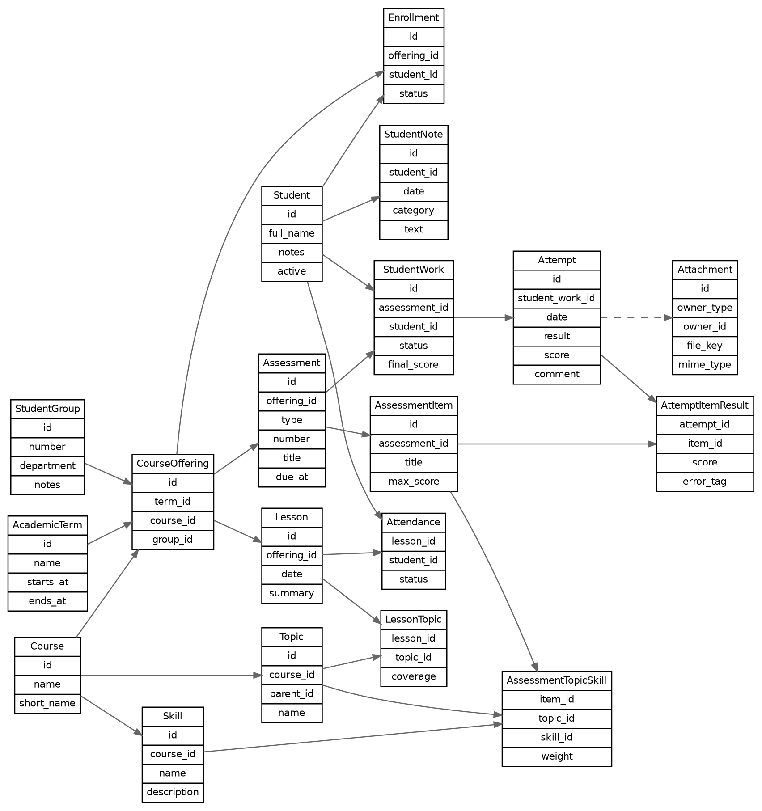
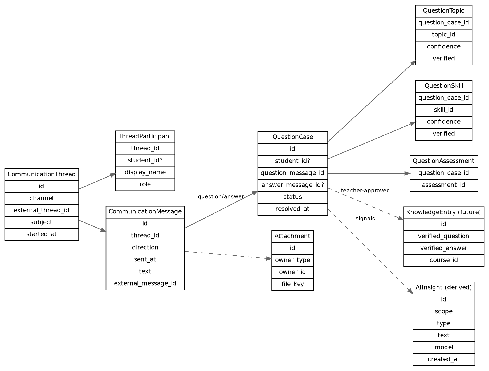

# Модель данных Studium

> Документ относится к Studium как независимому локальному приложению.
> Bender — отдельный проект; будущая интеграция использует локальный JSON-RPC
> 2.0 over stdio. Прямые импорты Bender, API/client, облачный сервер и новые
> возможности этим переносом не реализованы. Описания прежних фаз сохраняют
> технические требования; их проверки и acceptance не подтверждены этим текстом.

## Дополнение v9 — ежедневная работа (Iteration 4, ADR-045)

Head `0009_daily_workflow`: 79 user tables / 80 с Alembic. Две additive связи:
`SeminarProblem` → seminar_materials + problems и `ProgramModuleTopic` →
program_modules + topics. UUID/UTC/revision/soft-delete, уникальность пары,
FK RESTRICT и совпадение Course. Topic.parent_topic_id остаётся канонической
иерархией; темы могут переиспользоваться в нескольких модулях/семестрах.
Навыки показаны через прежнюю TopicSkill. Факты работ и попыток не менялись.

FileAsset extension CHECK расширен DOC по отдельному прямому разрешению
пользователя: transaction rebuild сохраняет исходный DDL/rows/indexes/triggers,
добавляя только `'doc'`. Проверяются populated v8 → head, повторное открытие,
source removal, FK/integrity и rollback при позднем сбое. Исторические 0001–0008
не меняются. Категории Works/Progress — DTO/UI, новых persisted aggregates нет.

## Дополнение v8 — назначения и варианты задач (Iteration 3, ADR-044)

`0008_problem_variants` добавляет только пять колонок в `problems`, индексы и
защитные triggers; число пользовательских таблиц остаётся 77. Миграции 0001–0007
не меняются. Старые задачи получают пустые назначения и остаются standalone.

`ProblemPurpose`: SEMINAR / CONTROL / EXAM / CONSULTATION. `purposes_json`
содержит канонический массив enum-значений, допускает несколько назначений и
отделён от свободных tags. Фильтры и генерация учитывают эту классификацию.

Та же `Problem` представляет standalone задачу, семейство (`is_family=True`)
или конкретный вариант (`family_id`, непустой `variant_code`). Семейство хранит
общее условие, code/title, topics/skills, tags, collections и purposes. Вариант
хранит параметры, ответ, решение и свои схемы/файлы через прежний FileAsset.
Shared statement/classification не дублируются в дочерних строках. Один Course,
уникальный код внутри семейства, неизменяемый тип и parent, запрет family как
конкретной выдаваемой задачи проверяются application и DB constraints/triggers.

Application разрешает вариант в effective DTO с общим условием/параметрами,
наследованными skills и объединёнными shared/variant файлами. Generator и
TicketSet переиспользованы; review устаревшего family revision отклоняется.
Выданные условия/teacher snapshots/назначения сохраняются после изменения
источника. Старые TicketSets, attachments и attempts миграция не переписывает.

## Дополнение v7 — Work Programs

`0007_work_programs` после v6: 30 новых таблиц, 77 user tables / 78 с Alembic.
Course остаётся дисциплиной. UUID/UTC/revision/soft delete и конкретные FK
применяются ко всем новым записям; физическое удаление фактов запрещено.

| Сущности | Контракт |
|---|---|
| WorkProgram / ProgramModule | Course, AcademicTerm, направление, факультет, версия, Autumn/Spring, первая неделя, duration (default 17), offset; модули с порядком и непересекающимися диапазонами |
| ProgramWork | M2M definition ↔ program: module/order/issue week/due week/dates; одна discipline; schedule в пределах программы/модуля |
| ProgramTopic / Skill / Material / Literature / Attachment | Каталоги программы и официальный PDF через прежний FileAsset |
| HomeworkPack / PackWork / PackAttachment | Общий комплект для нескольких ДЗ; файлы переиспользуются без копирования bytes |
| MethodicalMaterial / Attachment | Reusable course content, отдельно от SeminarMaterial |
| KnowledgeEntry / Source / Material / Topic / Skill | Ручной draft, M2M исходные QuestionCase/Message и материалы; distinct occurrences и даты вычисляются |
| DefinitionProblem / Topic / Skill | Reusable структура определения ДЗ/РК |
| ProblemTopic / Skill | Сквозная таксономия банка задач одной discipline |
| AssessmentProblem / Attachment | Bank source и snapshot конкретной работы; прямые общие файлы работы |
| StudentProblemAssignment / File | Индивидуальное условие/teacher snapshot/skill IDs и immutable FileAsset FK; после Attempt новое назначение запрещено |
| AttemptSkillResult | Immutable factual Skill outcome внутри AttemptItemResult; результат задачи и навыка независимы |

Изменённые записи: StudentGroup.faculty_short отдельно от faculty;
CourseOffering.work_program_id; Assessment.program_work_id; HomeworkDefinition.type
(WorkDefinition — alias); Problem.identifier (unique nonblank per course);
SeminarMaterial.lesson_type; Lesson.planned_date/planned_week/module_id/cancelled/reason.

Миграция создаёт отдельную default-программу для каждого legacy offering,
привязывает старые работы, сохраняет все прежние columns/revisions/bytes.
Плановое присутствие в Journal не создаёт Attempt. Новый Homework не принимает
REJECTED; прежние факты сохраняются. Transfer меняет actual date, сохраняет план;
cancelled Lesson остаётся в истории и исключается из attendance analytics.
Week/date selectors используют calendar выбранной программы. [ADR-039–041](decisions.md).

## Дополнение v6 — Content Workflow (история)

`0006_content_workflow` после v5: 47 user tables, 48 с Alembic. Новые 16:
homework_definitions, problems, problem_collections, problem_collection_members,
seminar_materials, seminar_material_topics, literature_items, четыре concrete
*_attachments, ticket_sets, tickets, ticket_problems, ticket_problem_files,
ticket_assignments. Все содержат прежнюю EntityMetadata. Mutable libraries,
immutable ticket composition/content, revisioned assignments; no physical delete.

| Модель | Поля/смысл |
|---|---|
| AcademicWeekNumber | >=1, odd/even вычисляется |
| AcademicTerm.week_utc_offset_minutes | -840..840, default 180, fixed calendar offset |
| Assessment | nullable planned_issue_week/planned_due_week; due >= issue; nullable homework FK |
| Lesson.type | SEMINAR / LECTURE, legacy default SEMINAR |
| HomeworkDefinition | Course/title/label/description/notes/tags/files |
| Problem | Course/title/statement/correct_answer/solution/difficulty/notes/tags/files |
| ProblemCollection / Member | Course/title/notes + many-to-many concrete pair |
| SeminarMaterial / Topic | Course/title/week?/plan_text/full_text/Topic links/files |
| LiteratureItem | Course?/title/authors/year?/type/notes/tags/files |
| TicketSet / Ticket | offering/assessment?/title/criteria snapshot; ordered variant numbers |
| TicketProblem / File | ordered immutable text/teacher snapshot/source revision + FileAsset FK/role |
| TicketAssignment | set/ticket/Enrollment FK, one assignment per student/set, revision check |

Tags — один canonical JSON-array contract; collections отдельны. Files —
прежние immutable originals, без BLOB/полиморфных owners. Student output
исключает teacher data. История сроков/снимков — ADR-036–038. Source diagrams
сохранены; ниже контракты предыдущих фаз.

Основание: ТЗ §§4–8/11–14, приложение A и задания partial Phase 1 / Phase 1R / Phase 2 / Phase 3. Доменная семантика ADR-008–ADR-012 перенесена в Python без redesign. Историческая production schema v1 содержит десять сущностей; additive v2 добавляет учебную модель (ADR-019–ADR-022), v3 — FileAsset/AttemptAttachment, v4 — QuestionCase/Message и пять типов связей (ADR-027–ADR-029).

## Контракт локального ядра v1

Исходники: [domain](../src/studium/domain/entities/__init__.py), [ORM models](../src/studium/infrastructure/database/models/__init__.py), [Alembic v1](../src/studium/infrastructure/database/migrations/versions/v0001.py), [SQL snapshot](../src/studium/infrastructure/database/migrations/versions/v0001.sql), [DB contracts](../tests/database/test_contracts.py). Все сущности содержат EntityMetadata: id (EntityId/UUID), created_at/updated_at (UtcInstant), revision >= 1, deleted_at nullable. Dataclasses frozen; SQLite хранит UTC epoch microseconds INTEGER, LocalDate — проверенный YYYY-MM-DD TEXT. ID/created_at стабильны, update увеличивает revision ровно на 1 и не уменьшает updated_at.

| Domain entity / SQL table | Поля ядра помимо metadata |
|---|---|
| AcademicTerm / academic_terms | name, starts_on/ends_on (LocalDate), archived |
| Course / courses | name, short_name, description |
| StudentGroup / student_groups | number, department, faculty, notes |
| CourseOffering / course_offerings | term_id, course_id, group_id; auth/ownership отложены |
| Student / students | full_name, preferred_name?, notes, active |
| Enrollment / enrollments | student_id, offering_id, enrolled_at, status ACTIVE/WITHDRAWN/COMPLETED, ended_at? |
| Assessment / assessments | offering_id, type, number?, title, description, issued_at, due_at?, max_score? |
| StudentWork / student_works | assessment_id, student_id; состояние только в StudentWorkProgress |
| Attempt / attempts | student_work_id, attempt_no, occurred_at, result, comment, score?, max_score? |
| Grade / grades | attempt_id, kind PASS_FAIL/NUMERIC/TRADITIONAL, passed?, score?, max_score?, label? |

Имена presented_at/status/teacher_comment из задания отображены на occurred_at/result/comment исходной модели. AttemptResult сохранён: PRESENTED, NEEDS_REVISION, ACCEPTED, SCORED, REJECTED, COMMENT_ONLY. Каждая новая попытка имеет отдельный UUID и возрастающий attempt_no. max_score Attempt — исторический снимок; Grade не меняет первичные данные, NUMERIC совпадает с ними, PASS_FAIL согласован с результатом, TRADITIONAL не преобразуется в число.

StudentWorkProgress: NOT_STARTED из пустой истории; PRESENTED → SUBMITTED; NEEDS_REVISION → REVISION_REQUIRED; ACCEPTED → ACCEPTED. Эти три события заменяют балл включая null; SCORED меняет балл, сохраняет статус (из NOT_STARTED даёт SUBMITTED); REJECTED/COMMENT_ONLY нейтральны. Порядок — attempt_no, не occurred_at. Soft-deleted факты сохранены и исключены из текущей проекции; attempt_count включает все активные факты. Полные analytics/overrides остаются OPEN-002.

DB constraints: FK ON DELETE RESTRICT и foreign_keys=ON на каждом connection; UNIQUE(student_id, assessment_id) и UNIQUE(student_work_id, attempt_no), включая удалённые записи; UNIQUE Grade.attempt_id; partial UNIQUE активного Enrollment и запрет пересекающихся membership intervals. Новая StudentWork требует active membership в offering Assessment. Triggers защищают metadata/revision, primary facts Attempt/Grade и исторический контекст; StudentWork/Attempt/Grade физически не удаляются обычным SQL. Это минимальная защита истории, не audit/purge engine.

Repository Protocol находятся в domain; SQLAlchemy implementations — в infrastructure. Семь mutable repositories, StudentWork insert/progress/soft_delete, Attempt append/history/soft_delete, Grade read. Attempt + Grade атомарны; update/soft_delete используют expected_revision. Alembic revision `0001_local_core` создаёт production v1 без create_all; future migration имеет down_revision и tests. Непустая unversioned/unknown-version БД не пересоздаётся; reopen сохраняет факты. Подробности connection policy/WAL — [architecture.md](architecture.md).

Topic/Skill, Lesson/Attendance, AssessmentItem и их связи реализованы в additive v2; FileAsset/AttemptAttachment — в additive v3. Q&A реализована в v4; AttemptItemResult добавляется в v5 Phase 6. StudentNote, AuditEvent, AIInsight и KnowledgeEntry остаются будущими расширениями. Phase 2 использовала десять сущностей без добавления таблиц. Student.notes — общая характеристика; датированные StudentNote остаются вне текущей фазы.

## Application-контракт Phase 2

[StudiumService](../src/studium/application/services.py) получает domain repositories и transaction/preferences ports. Создание Student + Enrollment атомарно; редактирование использует исходную revision. DTO списков/матрицы/истории содержат domain values, не SQLAlchemy rows. Matrix читает согласованный snapshot пакетами; состояние не сохраняется как таблица/кэш.

Desktop create_offering переиспользует активную тройку term/course/group, не меняя отсутствие DB UNIQUE этой тройки. Активный период — preferences.json, не колонка AcademicTerm. Список показывает последний Enrollment студента в контексте; завершённые memberships доступны через флажок, повторное участие — новый исторический интервал.

При открытии работы get/create переиспользует уникальную пару student/assessment; deleted Work не создаётся заново. Следующий attempt_no учитывает также deleted facts; UNIQUE + monotonic trigger и ограниченный retry защищают конкурентные append. Grade остаётся отдельной optional оценкой с исходными score/max. История старых Attempt/Grade read-only в UI. Физическая schema v1 не меняется, новые production migrations не нужны.

Абсолютные даты UI преобразуются через локальное время Windows ↔ UTC; AcademicTerm даты остаются LocalDate. issued_at обязателен в v1: пустое поле новой работы означает creation time, при edit — прежнее значение. Общая характеристика — Student.notes. Подробности и нерешённые части — ADR-016–ADR-018, OPEN-002/009/010/011.

## Общие правила

Основные сущности используют UUID. Для ядра v1 created_at/updated_at/revision/deleted_at и календарные даты определены ADR-008/ADR-011/ADR-015. Служебные поля серверной ownership/revision будущих фаз остаются открытыми. Временные метки — UTC; отображение — локальное.

Схемы укрупнённые: служебные поля пропущены, `date`/`coverage` на рисунке соответствуют более подробным `occurred_at`/`coverage_level` в тексте. Для рабочей терминологии используем таблицу §7 и enum приложения A. `Grade` отсутствовал в таблице/ER исходников; контракт локального ядра определён ADR-009, OPEN-001 закрыт.

## Реализованный контракт учебной модели v2

Миграция: `0002_learning_model`, down_revision `0001_local_core`, [SQL snapshot](../src/studium/infrastructure/database/migrations/versions/v0002.sql). Новые entities — frozen dataclasses с EntityMetadata, UUID, UTC timestamps, revision и deleted_at. Metadata есть также у всех связей. Пустые optional title/description/notes представлены строкой `""`; ссылки/максимумы nullable.

| Entity / table | Поля помимо metadata |
|---|---|
| Topic / topics | course_id → Course, parent_topic_id? → Topic той же дисциплины, title, description, sort_order >= 0 |
| Skill / skills | course_id → Course, title, description, sort_order >= 0 |
| TopicSkill / topic_skills | topic_id, skill_id; UNIQUE пары; одна дисциплина |
| Lesson / lessons | course_offering_id → CourseOffering, lesson_date: LocalDate, title optional, notes optional |
| LessonTopic / lesson_topics | lesson_id, topic_id; UNIQUE пары; факт реально пройденной темы |
| Attendance / attendance | lesson_id, enrollment_id → Enrollment того же offering, status, comment |
| AssessmentTopic / assessment_topics | assessment_id, topic_id; UNIQUE пары |
| AssessmentSkill / assessment_skills | assessment_id, skill_id; UNIQUE пары |
| AssessmentItem / assessment_items | assessment_id, title, description optional, max_score? > 0 finite, sort_order >= 0 |
| AssessmentItemTopic / assessment_item_topics | assessment_item_id, topic_id; UNIQUE пары |
| AssessmentItemSkill / assessment_item_skills | assessment_item_id, skill_id; UNIQUE пары |

Topic — содержание Course, независимо от группы; parent не может создавать цикл, включая прямой SQL update. Skill может относиться к нескольким Topics. Lesson — факт конкретного offering; отсутствие LessonTopic не означает прохождения по плану. LessonTopic не имеет coverage enum в этой фазе: преподаватель фиксирует сам факт разбора, без спорного уровня освоения. Исходный CoverageLevel сохраняется как будущая терминология, не как реализованное поле.

AttendanceStatus: PRESENT/ABSENT/LATE/EXCUSED/UNKNOWN из приложения A. Отсутствующая запись означает «не отмечено», не ABSENT и не UNKNOWN. Student получается через Enrollment; UNIQUE(lesson_id,enrollment_id) и trigger не допускают двух отметок для одного Student через повторные memberships. Withdraw/soft delete Enrollment не уничтожает существующий факт. Lesson.date не timestamp, поэтому принадлежность по UTC-интервалу автоматически не выводится; OPEN-009 остаётся открытым.

Шесть типов связей — отдельные нормализованные таблицы, без nullable-полиморфного AssessmentTopicSkill/фиктивного Item. Темы и навыки целевой записи принадлежат Course её offering. Связи работы и её частей независимы; автоматического наследования и агрегированной оценки освоения нет. Максимумы Items не обязаны суммироваться в Assessment.max_score, веса и оценки освоения не введены. В Phase 3/v2 части описывали только проверяемое содержание; Phase 6/v5 добавляет отдельный AttemptItemResult, сохраняя исходный итог всей работы в Attempt.

FK RESTRICT и indexes на основных/reverse связях; immutable owner IDs; стабильные UUID/created_at, next revision и неубывающий updated_at; no physical delete. Archive Topic атомарно архивирует поддерево, links сохраняются. Archive Skill/Item/Lesson — soft delete. Detach links ставит deleted_at; повторный attach сохраняет UUID и увеличивает revision. В v2–v4 mappings изменяемы; v5 запрещает семантические edits после первой Attempt (ADR-030, OPEN-014 RESOLVED). Metadata не является полной историей всех редакций; прежние версии/audit остаются OPEN-011.

Application: list/create/update/archive Topic/Skill; ordered TopicNode hierarchy; list/create/update/archive Lesson, atomic topics; explicit attach/detach всех шести связей; Attendance mark/update/list с revision snapshot; list/create/update/archive/reorder AssessmentItem. CRUD delete в локальном UI означает archive. UI получает domain values и frozen AttendanceEntry/TopicNode, не ORM. ContentForm/TopicSkillsDialog/LessonForm проверяют исходный snapshot связей, перестановка Items — их revisions.

## Учебная структура и занятия

Во всех таблицах основной ID подразумевается, даже если исходная строка §7 его не повторяет.

| Сущность | Назначение | Поля из ТЗ и связи |
|---|---|---|
| `AcademicTerm` | Учебный период | name, starts_at, ends_at, archived |
| `Course` | Дисциплина | name, short_name, description |
| `StudentGroup` | Учебная группа | number, department, faculty, notes |
| `CourseOffering` | Дисциплина для группы в периоде | term_id → AcademicTerm, course_id → Course, group_id → StudentGroup, teacher_owner_id |
| `Student` | Студент | full_name, preferred_name?, notes, active |
| `Enrollment` | Историческая привязка к потоку | student_id → Student, offering_id → CourseOffering, enrolled_at, status, ended_at?; контракт v1 ADR-012 |
| `Topic` | Иерархическая тема дисциплины | v2: course_id, parent_topic_id?, title, description, sort_order; §7 называл parent_id/name |
| `Skill` | Проверяемый навык/learning outcome | v2: course_id, title, description, sort_order; §7 называл name |
| `Lesson` | Фактически состоявшееся занятие | v2: course_offering_id, lesson_date, title, notes; date/summary/homework_notes ТЗ уточнены заданием Phase 3 |
| `LessonTopic` | Прохождение темы на занятии | v2: lesson_id, topic_id; coverage_level отложен по разрешённому упрощению задания |
| `Attendance` | Посещаемость студента | v2: lesson_id, enrollment_id → Enrollment → Student, status, comment |
| `StudentNote` | Датированное наблюдение преподавателя | student_id → Student, category, occurred_at, text |

`Student` связан с несколькими потоками через `Enrollment`; текущее поле группы не заменяет историю. Статусы/интервалы Enrollment уточнены ADR-012 (OPEN-008 закрыт). Согласованность Topic/Skill/Attendance реализована в v2; историческая v1 не меняется.

## Работы, попытки и оценки

| Сущность | Назначение | Поля из ТЗ и связи |
|---|---|---|
| `Assessment` | ДЗ, контрольная, защита и другая работа | offering_id → CourseOffering, type, number, title, description (§4.5), issued_at, due_at, max_score |
| `AssessmentItem` | Необязательная задача/критерий | v2: assessment_id, title, description, max_score?, sort_order |
| `AssessmentTopic` / `AssessmentSkill` | Проверяемое содержание всей работы | v2: assessment_id + topic_id / skill_id |
| `AssessmentItemTopic` / `AssessmentItemSkill` | Проверяемое содержание элемента | v2: assessment_item_id + topic_id / skill_id; заменяют исходный AssessmentTopicSkill в уточнённом объёме |
| `StudentWork` | Идентичность работы студента | assessment_id → Assessment, student_id → Student; status/final_score вычисляются в StudentWorkProgress |
| `Attempt` | Историческое предъявление/переделка | student_work_id → StudentWork, attempt_no, occurred_at, result, score?, max_score?, comment; отдельный enum типа события не введён |
| `AttemptItemResult` | Результат отдельной задачи конкретной Attempt, v5 | attempt_id → Attempt, assessment_item_id → AssessmentItem, outcome?, score?, max_score?, teacher_comment?, metadata |
| `Grade` | Оценка конкретной попытки | attempt_id → Attempt, kind, passed?/score?/max_score?/label?; ADR-009 |

Одна Assessment назначается студентам через StudentWork; работа студента содержит много Attempt. В ядре v1 membership и назначение определены ADR-012. Вложения Attempt реализованы в v3. В v5 Item результата должен принадлежать той же Assessment, что StudentWork; cross-assessment result отвергается domain/application/SQL. Уточнённое задание Phase 6 вводит outcome и maximum; error_tag/автоматическая интерпретация ошибок исходного ТЗ не добавляются без отдельной модели.

`AssessmentItem` опционален. Привязки всей работы и её частей реализованы отдельно; фиктивный обязательный item не создаётся. OPEN-004 уточнён ADR-019/021: остаток относится к прямым Lesson → выданная Assessment/Skill из более широкого ТЗ, не к реализованным связям Phase 3.

## Реализованный коммуникационный контракт v4

Основание — отдельное задание Phase 5 от 2026-10-01, FR-12–FR-14, ADR-027–ADR-029. Domain: [communication.py](../src/studium/domain/communication.py); application: [communication_services.py](../src/studium/application/communication_services.py); migration: [v0004](../src/studium/infrastructure/database/migrations/versions/v0004.py).

Все семь сущностей/таблиц имеют UUID, created_at/updated_at UTC microseconds, revision >= 1 и deleted_at; FK RESTRICT, immutable identity/owners и no physical delete.

| Entity / table | Содержание и ограничения |
|---|---|
| QuestionCase / question_cases | student_id обязателен; course_offering_id?, title?, opened_at, closed_at? >= opened_at; Student/offering/opened_at immutable |
| Message / messages | question_case_id, author_role STUDENT/TEACHER, channel MANUAL/EMAIL/TELEGRAM/OTHER, sent_at UTC, body исходный; все факты immutable; external_system/account_key/thread_id/message_id nullable |
| MessageAttachment / message_attachments | message_id, file_asset_id, caption?, sort_order >= 0; UNIQUE пары включая tombstone; detached link immutable |
| QuestionCaseAssessment / question_case_assessments | question_case_id + assessment_id UNIQUE; offering совпадает |
| QuestionCaseAttempt / question_case_attempts | question_case_id + attempt_id UNIQUE; Attempt → Work.Student совпадает с case.Student, Assessment.offering совпадает |
| QuestionCaseTopic / question_case_topics | question_case_id + topic_id UNIQUE; Course совпадает с CourseOffering |
| QuestionCaseSkill / question_case_skills | question_case_id + skill_id UNIQUE; Course совпадает с CourseOffering; факт связи не означает неосвоенный Skill |

Связи Assessment/Attempt независимы: попытка не создаёт Assessment link автоматически. Topic/Skill many-to-many, вводятся вручную. Для educational links выбран offering; у общего вопроса их нет. Student не обязан иметь активный Enrollment только ради capture переписки: это контекст вопроса, а не новый membership. Владельцы case не перемещаются обычным update; ошибочный case архивируется и вводится заново.

Create сохраняет непустой первый STUDENT Message и optional context атомарно. Каждая следующая запись отдельная; порядок `(sent_at, created_at, UUID)`, последние два поля — детерминированное разрешение одинаковых sent_at. Backdated response позже введённого Student message не меняет ожидание, если его sent_at раньше. Message раньше opened_at отвергается.

State вычисляется: closed_at != null → «Закрыт»; иначе последний активный Message TEACHER → «Ответ дан»; иначе STUDENT (или нет активных сообщений) → «Ожидает ответа». CommunicationState — только enum query projection, не колонка/source of truth. Close не предшествует последнему активному sent_at; продолжение закрытого case требует reopen. Archive скрывает case из активных queries и сохраняет Messages/context/assets.

Редактирования Message нет. Текст сохраняется без strip/summary; metadata отличается от исходного sent_at. Explicit application archive_message с expected_revision исключает ошибочный факт из текущей проекции, сохраняет body/role/channel/date и повышает revision; пользователь может добавить корректную новую запись. UI не предлагает незаметное редактирование. Это не audit log; OPEN-011 остаётся OPEN.

External key: **(external_system, external_account_key, external_thread_id, external_message_id)**, все четыре nonblank opaque strings либо все NULL. Для MANUAL они всегда NULL; ручной capture EMAIL/TELEGRAM также без external identity. UNIQUE действует включая soft-deleted rows. Provider namespace включает способ/версию нормализации, account key обозначает конфигурационную identity без секрета, thread_id — стабильная область ID провайдера (для account-global IDs adapter обязан определить постоянную namespace). Нельзя использовать изменяемую UI-группировку, адрес файла, body hash или только message_id как identity.

Replay той же identity и тех же case/author/channel/sent_at/body возвращает прежний Message. Другая body/роль/date/case → явный conflict, без перезаписи; tombstone не восстанавливается импортом. Concurrent insertion защищена UNIQUE; будущий adapter обязан retry/re-read при локальном storage conflict. Не утверждается, что provider adapters уже существуют или их normalization проверена live. OPEN-013 RESOLVED на уровне data contract (ADR-028).

MessageAttachment использует тот же FileAsset и физический pipeline Phase 4. Import нового файла → новый asset; explicit attach_file_asset_to_message может переиспользовать существующий immutable asset, включая файл Attempt. Detach одной link сохраняет остальные и bytes. Asset archive запрещён при active AttemptAttachment **или** MessageAttachment, даже если case/Message архивирован. Для освобождения ссылок требуется explicit detach; purge/GC/backup не добавлены.

CommunicationImporter / ImportedCommunication задают будущую boundary; требуется explicit Student/case resolution до записи. Хороший TEACHER Message уже имеет stable source UUID для будущего KnowledgeEntry; FAQ/AI answers сейчас отсутствуют. Search ищет literal Unicode casefold substring по Student.full_name/title/активному body. Будущая аналитика получает даты/роли/каналы/связи и исходные факты, без автоматически приписанного mastery.

## Целевая терминология коммуникаций исходного ТЗ

| Сущность | Назначение | Поля из ТЗ и связи |
|---|---|---|
| `CommunicationThread` | Диалог/цепочка | channel, external_thread_id, subject, started_at |
| `ThreadParticipant` | Участник | thread_id → CommunicationThread, student_id? → Student, display_name, role |
| `CommunicationMessage` | Исходное сообщение | thread_id → CommunicationThread, direction, sent_at, text, external_message_id, reply_to_id? → CommunicationMessage |
| `QuestionCase` | Учебный кейс вопроса/обсуждения | student_id? → Student, question_message_id → CommunicationMessage, answer_message_id? → CommunicationMessage, status, resolved_at |
| `QuestionTopic` | Связь вопроса с темой | question_case_id → QuestionCase, topic_id → Topic, confidence?, teacher_verified |
| `QuestionSkill` | Связь вопроса с навыком | question_case_id → QuestionCase, skill_id → Skill, confidence?, teacher_verified |
| `QuestionAssessment` | Связь вопроса с работой | question_case_id → QuestionCase, assessment_id → Assessment |

CommunicationThread содержит участников и сообщения. QuestionCase указывает исходный вопрос и возможный ответ, а тематические связи хранятся отдельно. Внешний участник может не соответствовать известному Student; неизвестный автор не должен вынуждать создавать фиктивного студента.

Требуется возможность связать вопрос/сообщения с Student, CourseOffering, Assessment, Attempt, Topic, Skill. В исходной таблице нет offering_id/attempt_id и связи кейса с несколькими сообщениями, хотя §5.1 это допускает. Эти исходные вопросы решены для student-owned линейного сценария заданием Phase 5 и ADR-027 (OPEN-003 RESOLVED); отдельный внешний диалог с неизвестными участниками не реализован. Значения confidence и teacher_verified не заменяют сохранённый исходный текст. Data contract внешней identity определён ADR-028 (OPEN-013 RESOLVED); реальные provider adapters потребуют отдельного задания.

## Вложения, аудит и будущие выводы

### Реализованный file contract v3

`0003_attachments`, down_revision `0002_learning_model`, [migration](../src/studium/infrastructure/database/migrations/versions/v0003.py), [SQL snapshot](../src/studium/infrastructure/database/migrations/versions/v0003.sql). Две дополнительные таблицы; schema содержит 23 user tables + alembic_version. Исходные v1/v2 не изменены. Все records имеют EntityMetadata/UUID/UTC/revision/deleted_at.

| Entity / table | Поля и constraints |
|---|---|
| FileAsset / file_assets | original_filename (basename), storage_key UNIQUE relative `files/<UUID prefix>/<UUID>.<ext>`, mime_type, size_bytes INTEGER >= 0, sha256 lowercase hex 64; поля bytes/имени/key неизменяемы |
| AttemptAttachment / attempt_attachments | attempt_id → Attempt, file_asset_id → FileAsset, caption?, sort_order INTEGER >= 0, details_json JSON object (metadata связи); оба FK RESTRICT, UNIQUE пары включая detached |

FileAsset отделяет физические bytes от конкретного владельца. Стабильный UUID/key не зависит от исходного пути; source не хранится в БД. Student/Assessment/presented date берутся через Attempt.student_work_id → StudentWork; presented date соответствует existing Attempt.occurred_at. FileEntry возвращает оба объекта, Student, Assessment, Attempt и derived FileIntegrity. Этот контекст сохраняется и при archive родительской учебной записи.

Replacement не перезаписывает старый UUID/key: новая версия импортируется как новый FileAsset. Простая модель не deduplicates одинаковые hashes; separate imports — separate assets. FK позволяет multiple explicit links, но обычный UI только импортирует новые files для выбранной Attempt. Caption/order/details active link изменяемы с expected_revision; endpoints, ID/created_at и содержимое asset immutable на SQL boundary. Первичные факты Attempt/Grade и StudentWorkProgress не изменены.

Detach = soft delete AttemptAttachment, tombstone доступен через include_detached. Прежняя связь не перемещается на другую Attempt и не восстанавливается молча; UNIQUE пары остаётся. Physical delete запрещён обычным SQL. Archive FileAsset разрешён только без active links, original bytes остаются. Missing/corrupted не означают deleted_at и никогда автоматически не удаляют record. Audit/purge/backup — OPEN-011.

Integrity available/missing/corrupted вычисляется по physical size/hash при запросе, не хранится в schema. Read-only originals и no-overwrite UUID publication реализует file adapter; повреждение/пропажа определяется после перезапуска. Thumbnails/1400 px preview — cache, не domain entity/column/BLOB. captured_at не введён: EXIF не преобразуется в новый доменный факт.

В v4 MessageAttachment → FileAsset получил конкретный FK-owner; поля FileAsset сохранены. Guard «нет active links» учитывает также MessageAttachment. Для OCR/Vision/AI evidence позднее доступен FileAsset UUID/hash и исходная Attempt; derived records не добавлены сейчас. Локальная часть OPEN-007 определена ADR-023–ADR-026, более широкие владельцы/remote storage остаются в своих фазах.

### Исходная целевая терминология ТЗ

| Сущность | Назначение | Поля из ТЗ и связи |
|---|---|---|
| `Attachment` | Метаданные файла | owner_type, owner_id, file_key, original_name, mime_type, sha256, size |
| `AuditEvent` | История критичных изменений | entity_type/id, action, before_json?, after_json?, actor, time |
| `KnowledgeEntry` | Проверенный FAQ, future | course_id → Course, question_text, answer_text, source_question_case_id → QuestionCase |
| `AIInsight` | Производный вывод, future | scope_type/id, insight_type, text, evidence_json, model_info; версия промпта по §13.3 |

Attachment в исходном ТЗ объединяет metadata и owner. Phase 4 уточнила этот контракт отдельными FileAsset/AttemptAttachment с реальными FK; слабая owner_type/owner_id схема не реализована. Message реализован в v4; Lesson/другие owners — дальнейшие расширения (OPEN-007), §12.1 допускает отдельные link tables. File_key не равен абсолютному source path. Bytes — вне реляционной БД, ID стабилен.

AuditEvent нужен для удаления, массовых изменений и ручной коррекции итогов. AIInsight хранит evidence на исходные сущности, может быть пересчитан без изменения StudentWork, Attempt или Grade. Факты и аналитика имеют разный жизненный цикл; точная политика коррекций/удалений открыта (`OPEN-011`).

## Enum и статусы

Значения нормализованы по приложению A ТЗ; это целевая терминология. Communications enums этой исторической таблицы не являются schema v4: фактически реализованы MANUAL/EMAIL/TELEGRAM/OTHER, AuthorRole STUDENT/TEACHER и derived CommunicationState без status column (контракт выше).

| Enum | Значения |
|---|---|
| `AssessmentType` | HOMEWORK, TEST, CONTROL_WORK, DEFENSE, LAB, EXAM, OTHER |
| `StudentWorkStatus` | NOT_STARTED, SUBMITTED, REVISION_REQUIRED, ACCEPTED, MISSED, EXEMPT, CANCELLED |
| `AttemptResult` | PRESENTED, NEEDS_REVISION, ACCEPTED, SCORED, REJECTED, COMMENT_ONLY |
| `AttendanceStatus` | PRESENT, ABSENT, LATE, EXCUSED, UNKNOWN |
| `CoverageLevel` | INTRODUCED, PRACTICED, COMPLETED, REPEATED |
| `CommunicationChannel` | EMAIL, TELEGRAM, MANUAL, APP, OTHER |
| `MessageDirection` | INBOUND, OUTBOUND |
| `QuestionStatus` | OPEN, ANSWERED, RESOLVED, NEEDS_FOLLOWUP, ARCHIVED |
| `StudentNoteCategory` | OBSERVATION, STRENGTH, WEAKNESS, ORGANIZATIONAL, OTHER |
| `AttachmentSyncStatus` | LOCAL_ONLY, QUEUED, UPLOADING, SYNCED, FAILED |

У StudentWork `REVISION_REQUIRED`, у Attempt `NEEDS_REVISION`. `SCORED` не означает автоматически зачёт. `ANSWERED` и `RESOLVED` — разные значения. Просрочка является производным признаком, отдельного StudentWorkStatus для неё в ТЗ нет. Статусы Enrollment v1 и типы Grade определены ADR-012/ADR-009; отдельный тип события Attempt не вводился.

## Инварианты из ТЗ

| ID | Правило (§7.1 и первый промпт) | Будущая проверка |
|---|---|---|
| INV-01 | Не более одного активного StudentWork для пары Student + Assessment | Ограничение БД и повторное назначение |
| INV-02 | attempt_no уникален внутри StudentWork и монотонно возрастает | Транзакционная запись, порядок истории; два устройства — OPEN-010 |
| INV-03 | Новая переделка создаёт Attempt; предыдущая сохраняется. Archive/cancel Assessment не удаляет Attempt физически | Сохранение истории и запрет каскадного удаления |
| INV-04 | AIInsight не меняет StudentWork, Attempt или Grade без явного действия преподавателя | Изоляция производного слоя и подтверждение |
| INV-05 | Scoped external identity, уточнённая ADR-028 | UNIQUE provider/account/thread/message и проверенный replay/conflict; live import отсутствует |
| INV-06 | Attachment доступен по стабильному ID после перемещения физического файла | Перемещение и целостность SHA-256 |

Требуемые дополнительные проверки согласованности связей (Topic/Skill внутри Course, результаты внутри Assessment, участники/сообщения внутри диалога) оформляются с тестами и решениями в соответствующих будущих фазах. Они не подменяют неуточнённые правила истории Enrollment или исправления Attempt.

## Производные показатели

§6.3 задаёт: first_presented_at, accepted_at (первая ACCEPTED), attempt_count, revision_count (число NEEDS_REVISION), days_late, first_try_success и topic_mastery_score. §4.6 дополнительно требует дату последней переделки. Topic mastery — аналитический показатель, не первичный факт.

Правила metrics Phase 6 определены [analytics.md](analytics.md), ADR-031/032: StudentWorkProgress по attempt_no сохраняется; служебный COMMENT_ONLY не является сдачей, REJECTED влияет на первую сдачу, но не меняет прежний domain status/score. Нормированный итог использует исторический maximum того Attempt, который дал текущий score. Timeline — cutoff текущих фактов, не audit snapshot. Ручные overrides/полная история коррекций остаются OPEN-002/011; учебный timezone/date-only deadlines — OPEN-009.

## Результаты частей и analytics v5

[AttemptItemResult](../src/studium/domain/analytics_facts.py) — frozen entity с EntityMetadata, explicit Attempt/AssessmentItem FK, nullable ItemOutcome/score/max_score/teacher_comment. ItemOutcome: CORRECT, PARTIAL, INCORRECT, NOT_EVALUATED. Требуется outcome или score; maximum без score допустим как контекст outcome, но один maximum без результата недопустим. Score finite/nonnegative, maximum finite/positive, score <= max при обоих. Нет outcome-to-score conversion. Score без maximum — сохранённый факт, normalized score None.

Миграция [v0005](../src/studium/infrastructure/database/migrations/versions/v0005.py), SQL [snapshot](../src/studium/infrastructure/database/migrations/versions/v0005.sql): attempt_item_results, 31 user tables + alembic_version, FK RESTRICT, partial UNIQUE активной пары Attempt/Item, reverse item index, identity/revision/fact/context/no-delete guards. Результат каждой Attempt независим; исправление — explicit archive и новая row, прежние UUID/facts/tombstones сохраняются. Physical delete/resurrection/overwrite запрещены.

Semantic lock после любой первой Attempt замораживает содержание Assessment/Item и четыре вида их Topic/Skill links. Связанные Topic/Skill и предки Topic защищены от изменения смысла/иерархии/архива; presentation sort_order можно менять. TopicSkill не используется как автоматическое evidence, его mapping не обязан замораживаться. Расписание и archive всей Assessment остаются явными текущими изменениями. До первой Attempt содержание изменяемо по прежним правилам. Existing v1–v4 facts не преобразуются и не удаляются; прошлый meaning до v5 не реконструируется при отсутствии редакций.

StudentProgressSummary, GroupAnalyticsSummary, AssessmentAnalytics (+AssessmentItemAnalytics), TopicEvidenceSummary, SkillEvidenceSummary, QuestionAnalyticsSummary, AttendanceSummary и AnalyticsTimePoint содержат только query values. Rates/normalized scores — 0..1 либо None; count=0 не равен недостающему score. DB хранит факты, без completion/attendance/mastery percentages. Evidence uses typed distinct source UUID; Topic rollup не считает parent+child mapping дважды. Все определения/формулы/границы — [analytics.md](analytics.md).

## Миграции Phase 1R–3

Первая миграция v1 создана по принятым локальным контрактам. Перед следующей миграцией уточнить влияющие на неё OPEN-вопросы, поля/типы/nullability, enum и ограничения. Каждое изменение схемы получает Alembic revision с down_revision и тест переноса предыдущих данных; отдельные тесты проверяют инварианты, soft delete и отсутствие потери истории. Новое хранилище не создаётся удалением существующей БД.

SQLite — единственная БД Phase 1R; production initial migration реализована через Alembic. Поля пригодности к sync планируются в модели, но PostgreSQL, outbox-протокол, загрузки файлов и AI не реализуются заранее. План работ — [todo.md](todo.md), нерешённые контракты — [decisions.md](decisions.md).
