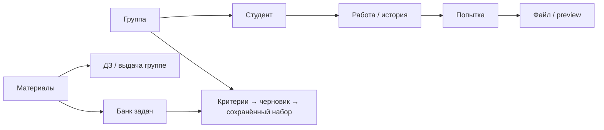

# Phase 6.6 — Workflow, Content Libraries & UX Iteration 1

> Документ относится к Studium как независимому локальному приложению.
> Bender — отдельный проект; будущая интеграция использует локальный JSON-RPC
> 2.0 over stdio. Прямые импорты Bender, API/client, облачный сервер и новые
> возможности этим переносом не реализованы. Описания прежних фаз сохраняют
> технические требования; их проверки и acceptance не подтверждены этим текстом.

PASS (99.23 s), Ruff format/check PASS; commit без изменения содержимого.

Статус: реализация завершена и проверена в описанном ниже объёме; ручная UX-приёмка
остаётся пользователю. Final Phase 6.6 commit не создан и требует отдельного
разрешения. Phase 7 и Iteration 2 не начаты.

Windows-first, local-first, offline-first. Server/sync/mobile/AI/OCR,
live Telegram/email, прогнозы и рейтинги отложены без даты начала.

## Приёмочный объём

Внутренняя навигация и Back/breadcrumb, раскрываемые группы, страница
«Добавить», четыре библиотеки, общий drag/drop и прежний FileAsset preview,
учебные недели, лекции/семинары, детерминированный генератор и исторические
снимки вариантов, factual QtCharts, additive migration 0006, regression,
populated migration copies, performance, Windows bundle и synthetic screenshots.

Исходные 40 разделов требований сохранены в [phase66-request.md](phase66-request.md).

## Реализованная навигация и потоки

`NavigationStack` хранит страницы и историю в единственном `MainWindow`/
`QStackedWidget`. Sidebar: Обзор, раскрываемые Группы, Материалы, Добавить;
Настройки снизу. Контекст группы показывает дисциплину и активный период.
Карточки студента, работ, попыток, тем, занятий, вопросов и файлов открываются
внутри главного окна; Back/Alt+Left возвращает на предыдущую страницу.
Сохраняется контекст и вкладки; обновление модели может сбросить выбор строки.
Dialogs оставлены для quick Attempt, небольшого ввода, подтверждения, picker и ошибок.

Вопросы доступны в группе, Student, Assessment и Attempt, с прежними ручными
каналами EMAIL/TELEGRAM. Первичная глобальная страница вопросов убрана.
Базовые Term/Course/Group CRUD находятся в «Добавить»; onboarding пустой базы сохранён.
Общий Fusion/light QSS и palette задают читаемые normal/selected/hover/focus/disabled
Combo popup items и календарь. Calendar.clicked сразу обновляет поле даты.

## Domain, schema и application

| Область | Реализация |
|---|---|
| Учебные недели | Pure `AcademicWeekNumber`, integer ≥ 1; нечётная — числитель, чётная — знаменатель |
| Планирование | `Assessment.planned_issue_week`, `planned_due_week`, `homework_definition_id`; прежние exact fields сохранены |
| Тип занятия | `LessonType.SEMINAR/LECTURE`; общий `Attendance`, прежние записи — SEMINAR |
| Материалы | `HomeworkDefinition`, `Problem`, `SeminarMaterial`, `LiteratureItem`, обычный текст/Markdown, metadata/archive |
| Наборы и темы | `ProblemCollection`/`ProblemCollectionMember`, `SeminarMaterialTopic`, многие-ко-многим |
| Теги | Единый `tag_document`/`TeachingContent` contract, Unicode casefold/dedup; collections имеют отдельную семантику |
| Файлы | Четыре concrete attachment tables, общий FileAsset storage, integrity/SHA-256/preview |
| Варианты | `TicketSet`, `Ticket`, `TicketProblem`, `TicketProblemFile`, `TicketAssignment` |
| FAQ | `FAQDraftContract`: reviewed question/answer, source QuestionCase, Course/Topics, inactive default; ADR-036; без таблицы/портала/AI |
| Application | `ContentService`: library CRUD/search/filter/archive/files, collections/topics, draft generation/replacement/save/assign; `WorkflowAnalyticsService`: WeekFacts и separate attendance DTO |

Pure domain не зависит от Qt/ORM. Application использует repository Protocols и
transaction ports; Qt получает domain/immutable DTO, не Session/ORM models.
Новых dependencies нет: QtCharts входит в уже установленный PySide6 Addons.
Runtime/dev/build locks и системный Python 3.12.10 сохранены.

**Migration `0006_content_workflow`** additive: 16 новых таблиц,
итого **47 user tables / 48 с alembic_version**. Добавлены nullable week/source
колонки Assessment, default SEMINAR у Lesson и fixed calendar offset у Term.
Статический SQL содержит FK/checks/unique/indexes, revision/ownership/context/file
guards и immutable ticket snapshots. Production не вызывает create_all, не
пересоздаёт БД. v1–v5 Python/SQL snapshots не изменены. Downgrade v6 отказан как
destructive operation; восстановление — из заранее сохранённой копии данных.

Новый inline FK `assessments.homework_definition_id` использует SQLite **NO ACTION**
(без cascade), эквивалентный ORM `ondelete=None`: SQLAlchemy SQLite reflection
не разбирает inline RESTRICT корректно. Фактический FK проверен PRAGMA, все прочие
новые FK — RESTRICT. Подробные основания и последствия: ADR-035–038.

Populated копии **v1/v2/v3/v4/v5 → v6**, fresh и повторное открытие проверяют
каждое прежнее значение строки, прежние views/triggers/indexes, exact dates,
Attempt/Grade/Attendance/QuestionCase/Message facts и bytes файлов. Оригинальные
базы не меняются. Test-only legacy adapters отражают настоящую прежнюю schema;
production использует только latest schema.

## Библиотеки и генератор

- **ДЗ:** Course/title/label/text/tags/files/notes/archive; «Выдать группе» копирует
  название/условие в самостоятельный Assessment со ссылкой на шаблон и неделями.
  Последующие правки шаблона не переписывают Assessment. Файлы шаблона остаются
  в библиотеке; автоматический student export и отдельный snapshot этих файлов
  при выдаче ДЗ не добавлены.
- **Банк задач:** отдельные вкладки Условие / Правильный ответ / Эталонные эпюры /
  Решение / Наборы / Заметки. Text, Course, tags и collection filters. Несколько
  reference images/PDF используют существующий storage/preview.
- **Семинары:** reusable plan/full text, неделя, Topic links, tags/files;
  материал подготовки отделён от реально записанного Lesson.
- **Литература:** Course optional, authors/year/type/tags/notes, несколько files;
  все пять типов из задания, поиск и фильтры.
- **Варианты:** Course контекста + все tags + collection + active pool. Seed и
  стабильная сортировка UUID воспроизводят состав на том же pool; уникальные
  unordered combinations, без повторов внутри варианта. Недостаточный pool —
  понятная ошибка, критерии не ослабляются. Генерация выполняется в worker.
  Черновик можно regenerate/replace, затем атомарно сохранить после проверки
  исходных revisions. Изменившаяся задача отклоняет весь save.
- **История:** TicketProblem копирует title/statement/answer/solution/revision,
  TicketProblemFile фиксирует FK к immutable bytes. Правки/архив исходного
  Problem не меняют сохранённые варианты. `StudentTicketProblem` — whitelist
  только условия/STATEMENT files, без answer/REFERENCE/SOLUTION.
- **Назначения:** текущий Enrollment roster по ФИО, N вариантов для N студентов
  либо ручное количество и неназначенные варианты. Есть просмотр Student→Variant,
  ручная замена, снятие и повторное назначение. Адаптивного подбора нет.

Генератор разделён на «Критерии», «Проверка состава», «Сохранённые наборы»;
это сохраняет доступность действий при 960 × 620. Не создаётся student portal
или отдельная export subsystem.

## Недели, посещаемость и графики

Неделя 1 начинается с `AcademicTerm.starts_on`; далее последовательные блоки
по семь календарных дней. Attempt UTC переводится в выбранный fixed offset
периода, по умолчанию UTC+03:00 для Moscow-контекста задания; parity вычисляется.
Начало/offset периода заблокированы после Attempt у работ с неделями.

**Exact due_at > planned_due_week.** Без exact срока первое содержательное
предъявление в due week/раньше — вовремя; после неё — поздно. Без предъявления
overdue начинается со следующей недели. COMMENT_ONLY не сдача. Без обоих сроков
сохраняется N/A. Legacy exact аналитика не меняется. `issued_at` сохраняет время
выдачи/создания; planned_issue_week дополнительно исключает ещё не планируемые
работы из текущего analytics среза.

Lecture/Seminar вводятся в той же форме и отмечаются тем же attendance механизмом.
DTO содержат общую и отдельную посещаемость. Student/Group сохраняют числовые
показатели и добавляют QtCharts: работы/своевременность, предъявления/попытки по
неделям, распределение attendance по типам. Week series ограничена календарём
периода; `planned_due` считает Assessment, первые сдачи — StudentWork, Attempts
считаются отдельно. Пустые/N/A данные безопасны, педагогических выводов нет.

## Drag/drop, preview и Windows

`FileDropZone` проверяет local regular files, подсвечивает drag-enter, поддерживает
multi-file drop и picker. Переиспользуется для Attempt, Message и всех четырёх
библиотек/teacher file roles. Импорт проходит прежний compensated/journaled
FileAsset pipeline; IO выполняется в worker на ежедневных страницах.
Image/PDF/thumbnail/default Windows application fallback переиспользованы из
Phase 4. Back освобождает PDF document и игнорирует запоздалый worker callback.

Qt/native source drag/drop проверен на настоящем Windows backend. **Explorer →
frozen exe не подтверждён автоматикой:** внешний тестовый OLE source зависает
до завершения передачи; этот helper удалён из финального smoke. Actual exe
проверен через настоящий native multi-file picker. Это ограничение QA, а не
заявленный PASS Explorer drag/drop; ручная проверка обязательна.

## Фактические проверки

| Проверка | Результат |
|---|---|
| Финальный pytest | **552 passed / 129.90 s**; +77 checks к baseline |
| Ruff | format --check: **155 files**; check PASS |
| Dependencies | pip check PASS; новых packages нет |
| Migration regression | Populated v1–v5 copies + fresh/reopen PASS; original rows/files/schema objects preserved |
| Native entry | Настоящий `python -m studium`, видимый Windows window, v6/47 user tables/FK, exit 0 |
| Native DPI/resize | Window DPR **1.0 / 1.25 / 1.5**, 960×620 / 1240×780 / 1600×900; Alt+Left, long Russian FIO/labels/filenames, Combo/calendar/drop/preview PASS |
| 1000 Problems, 3 collections, 30 students | Фильтр **0.0505 s / 2 SELECT**, generation30 **0.0987 s / 3 SELECT**; 500 matches, 30 variants |
| Group charts | Последовательный native QA: **0.1015 / 0.1028 / 0.0920 s** при DPR 1 / 1.25 / 1.5 |
| Portable build | PyInstaller 6.22.3; Python 3.12.10; QtCharts/PDF/Windows plugins и v6 resources включены |
| Actual exe | **fresh / populated v5 upgrade / workflow / reopen**, каждый exit 0; QtCharts, libraries, internal Back, snapshots, image/PDF, native multi-file picker PASS |
| Frozen persistence | v6, 47 user tables, PRAGMA integrity/FK PASS; все старые v5 values и bytes сохранены; новые library files переживают reopen |
| Git/source integrity | HEAD `[историческая ссылка опущена]`; ничего не staged; remote отсутствует; source DOCX/README/schemes, locks и migrations v1–v5 не менялись |

Wall-clock performance — измерение данного компьютера, не универсальный SLA.
Первоначальный строгий секундный assertion сработал при параллельных Windows/IO
проверках (1.053 s); финальный тест проверяет стабильный SQL budget против N+1,
а секунды публикует отдельно. Решение не скрывает failure и не меняет функционал.

Команды из корня с `.venv/Scripts/python.exe`:
`-m ruff format --check .`, `-m ruff check .`, `-m pytest -q`, `-m pip check`,
`scripts/smoke_desktop.py`, `scripts/smoke_packaged.py`,
`scripts/preview_phase66.py --scale 1 --native-base-scale 2` с Windows backend,
затем отдельно scale 1.25/1.5. Build: `scripts/build_windows.ps1`.

Build warnings о необязательных tzdata/pysqlite2/MySQLdb сохранены в игнорируемом
build log; local SQLite/fixed offset не требуют этих модулей. Actual exe успешно
выполняет v6 migration и charts/preview, silent missing-resource fallback не заявляется.

(9.73 MB / 9.28 MiB). Вся portable папка: **138 741 678 bytes**
(138.74 MB / 132.31 MiB). Переносить весь `dist/Studium`, включая `_internal`.
App data хранится отдельно, в `%LOCALAPPDATA%\Studium`; build/dist/tmp ignored.

## Synthetic dataset и screenshots

Сценарий `scripts/phase66_scenario.py`: Сопротивление материалов, Осень 2026,
МТ5-31 и дополнительная МТ5-32, по 20 синтетических студентов. 22 балки + 22 рамы,
«как в ДЗ» и РК1, отдельные ответы/эпюры, ДЗ №1–5, семинарные материалы недель
1–5, три literature entries, seminars + пять lectures и attendance, 20 сохранённых
вариантов по tags=балки/collection=как в ДЗ. Дополнены прежние 400 Attempts,
questions/files/item evidence. Все texts/PDF/images — synthetic placeholders.
Data roots всегда TemporaryDirectory; реальных студентов и copyrighted textbooks нет.

**23 PNG**, включая все 16 запрошенных экранов, сняты с Windows Qt при Window
DPR 1.0. Сводки: 100%,
DPI 125/150,
actual exe.

| Экран | Снимок |
|---|---|
| Главная навигация | [01-navigation](screenshots/phase66-01-navigation.png) |
| Раскрытые группы | [02-sidebar](screenshots/phase66-02-sidebar-groups.png) |
| Internal Student + Back | [03-student](screenshots/phase66-03-student-back.png) |
| Добавить | [04-add](screenshots/phase66-04-add.png) |
| ДЗ | [05-homework](screenshots/phase66-05-homework.png) |
| Банк задач | [06-problems](screenshots/phase66-06-problem-bank.png) |
| Ответ / эпюры | [07-answer](screenshots/phase66-07-problem-answer.png), [07b-epures](screenshots/phase66-07b-problem-epures.png) |
| Image / PDF preview | [07c-image](screenshots/phase66-07c-image-preview.png), [07d-pdf](screenshots/phase66-07d-pdf-preview.png) |
| Критерии генератора | [08-criteria](screenshots/phase66-08-ticket-criteria.png) |
| 20 вариантов / сохранённый набор | [09-generated](screenshots/phase66-09-generated-20.png), [09b-saved](screenshots/phase66-09b-saved-assignments.png) |
| Семинары | [10-seminars](screenshots/phase66-10-seminars.png) |
| Литература | [11-literature](screenshots/phase66-11-literature.png) |
| Drop highlight | [12-drop](screenshots/phase66-12-drag-drop.png) |
| Week selector / читаемый popup | [13-weeks](screenshots/phase66-13-week-selector.png), [13b-popup](screenshots/phase66-13b-combo-popup.png) |
| Lecture attendance | [14-lecture](screenshots/phase66-14-lecture-attendance.png) |
| Student charts | [15-student](screenshots/phase66-15-student-charts.png) |
| Group charts / типы attendance | [16-group](screenshots/phase66-16-group-charts.png), [16b-attendance](screenshots/phase66-16b-lecture-seminar-charts.png) |
| Long Russian labels/FIO | [17-long](screenshots/phase66-17-long-names.png) |

## A. Что проверить пользователю вручную

1. Запустить exe, открыть группу → Student → работу → Attempt → файл, вернуться
   Back/Alt+Left; оценить сохранение контекста, вкладок и выбор строки после refresh.
2. Перетащить **из Explorer в exe** несколько PNG/PDF во все file-enabled области,
   проверить highlight, импорт/preview, ошибки файлов и сохранность после restart.
   Это проверка с приоритетом: автоматический OLE source среды ограничен.
3. Создать ДЗ из библиотеки на недели 5–7; проверить числитель/знаменатель,
   отсутствие требования exact date и ожидаемую локальную границу недели.
4. Сформировать 20 вариантов tags=балки/«как в ДЗ», заменить задачу, сохранить,
   сменить/снять назначение, изменить исходный Problem и проверить старый snapshot.
5. Посмотреть Student/Group numbers/charts и lecture/seminar attendance; оценить
   русские длинные labels, keyboard и рабочие размеры на собственных мониторах.

## B. OPEN и спорные UX decisions

- Одна группа может иметь несколько sidebar links по дисциплинам; grouping вместо
  повторения context links — предмет пользовательской UX-приёмки.
- Неделя начинается с даты периода, а не обязательно с понедельника. Fixed offset
  по умолчанию Moscow +03:00; DST/общая политика calendar membership остаются OPEN-009.
- Exact due_at имеет приоритет. Редактирование срока пересчитывает timely без
  отдельного audit trail — прежний OPEN-011; новую историю сроков не заявляем.
- Week selector предлагает 1–52 (и расширяется для существующего большего номера),
  а не ограничивает выбор концом периода; этот UX можно уточнить после использования.
- Back сохраняет page/context/tab, но refresh может сбросить table selection.
- Выдача ДЗ копирует текст/source reference; отдельный snapshot шаблонных файлов
  и student ticket PDF export не реализованы и не заявлены.
- Plain text/Markdown без rich-text formatting; критерии/preview/saved tabs
  вместо одной длинной generator form; размеры/названия требуют человеческой оценки.
- Живой Explorer→exe drop требует ручного подтверждения. Реализация использует
  ту же проверенную Qt DropZone/application pipeline; ложный packaged OLE PASS отсутствует.

Блокеров реализации, тестов, миграций и build нет. Ограничение QA OLE и ручная
UX-приёмка явно остаются открытыми.

## C. Намеренно отложено, без начала Iteration 2

Selection persistence при refresh, refinement sidebar/filters/ширины карточек,
rich text/editor conveniences, deadline audit, отдельные template-file snapshots,
student ticket PDF/print/export, полноценный ручной FAQ UI, backup/GC/installer/
code signing. Это идеи, не утверждённый объём следующей итерации.
AI/OCR/agents/adaptive recommendations/ranking/prediction/live Telegram/email,
server/cloud/sync/mobile остаются за границей и без даты запуска.

Рабочая документация README/AGENTS/architecture/data-model/navigation/analytics/
decisions/roadmap/todo/done обновлена. Git: изменения Phase 6.6 остаются
unstaged/uncommitted; финальный commit только по отдельному разрешению пользователя.
