# Навигация и пользовательские потоки

## Учебная программа — новый основной маршрут

Дисциплины → создать дисциплину → Учебные программы → Создать / Открыть / Импорт.
Восемь вкладок: Паспорт, Годовой план, Результаты обучения, Предварительная
подготовка, Объём дисциплины, Баллы и задания, Материалы, Использование / версии.
Сохранение черновика отдельно от публикации; готовая версия read-only с действием
новой редакции/копии. Router и закрытие MainWindow проверяют несохранённое.
Использование → явный ordinal/preview → рабочий план группы с baseline/current
занятиями и отдельной связью факта. [Короткая инструкция](program-window.md#пользовательский-сценарий).

> Документ относится к Studium как независимому локальному приложению.
> Bender — отдельный проект; будущая интеграция использует локальный JSON-RPC
> 2.0 over stdio. Прямые импорты Bender, API/client, облачный сервер и новые
> возможности этим переносом не реализованы. Описания прежних фаз сохраняют
> технические требования; их проверки и acceptance не подтверждены этим текстом.

## Пакет 0.2.0 — текущие пользовательские потоки

Дисциплина → Рабочая программа: направления, программа и immutable версия
содержания. Группа → План семестра: отложенная/явная настройка, номер семестра,
независимые модули, preview переноса с предупреждениями и история. Создание работ
доступно из плана и списка работ; журнал открывает конкретное занятие или работу.

Работы → ДЗ / Контрольные / Экзамены / Другие: выбранная работа → Задачи и варианты
использует существующую генерацию Studium с фиксированным контекстом работы.
Студент → Прогресс открывает сводку, категории и обязательные работы модулей;
отдельная история показывает реальные сдачи, проверки и возвраты. Регистрация
сдачи и проверка сохраняют даты и staged файлы вместе; отмена формы не пишет факты.
Для старой истории доступен внутренний переход к прежним Attempts.

Главная → Очередь проверки объединяет все группы по фактическому получению;
проверенные сдачи остаются в истории. Долг прошлого периода открывает исходную
работу; завершённое участие не подменяется новым ACTIVE enrollment. Явно удалённый
контекст требует подтверждённого восстановления с причиной.

Редактор задачи: точное дерево тем, структурированные ответы преподавателя,
копирование шаблона, отдельная прокрутка вкладок и дополнительные параметры.
Общие staged вложения поддерживают выбор/drop, preview и удаление до сохранения.
[Все маршруты 30 ID и ожидаемые результаты](qa-all-30-manual.md).
Автоматические проверки не являются ручной приёмкой; она остаётся PENDING.

## Iteration 4 — предыдущие пользовательские потоки

Период справа вверху: выбор и «Управление периодами…» с Add/Edit/Delete.
Settings содержит тему и диагностику, без period CRUD. В footer sidebar перед
Settings — «Справка», MainWindow Help Center с поиском и article navigation.
Выбранный пункт sidebar выделяется фоном без отдельной вертикальной полосы.

Group редактируется в «Настройки группы»; overflow из header удалён. Journal
позволяет выделить Ctrl/Shift несколько attendance cells одной недели и
применить один статус только к ним. Enter/double activation открывает ячейку.
Заголовки работ ДЗ №n / РК №n, полные названия в tooltip. Обычные таблицы имеют
Interactive columns и локальное сохранение ширин; wide data прокручиваются.

Problem Bank: все desktop filters видимы, list + lazy image/PDF preview,
выбор схемы семейства. На узком экране «Предпросмотр» переключает list/preview,
«Список» возвращает фильтры. Seminar detail: План / Задачи / Файлы / Темы /
Заметки. Filtered multiselect банка и «Создать новую задачу» связывают реальные
Problem с семинаром; новая задача имеет SEMINAR purpose и ту же Course.

Student Works: Домашнее задание / Рубежный контроль / Экзамен → работа → вся
история Attempt и её файлы. Progress — те же категории и per-work факты:
состояние, count, первая/последняя сдача, дата зачёта, относительно срока.
Сводка, факты по темам/навыкам и графики остаются вторичными представлениями.
Темы дисциплины: семестр/программа → модуль → тема → подтема → связанные навыки;
вне-модульные темы сохраняются. «Новая тема», «Добавить подтему», «Изменить»,
«Удалить» вместо обычных Up/Down. Для Group/Problem/material/program metadata
обычные поля видимы; длинные forms прокручиваются, Save остаётся снаружи.

Delete actions сохраняют учебную историю и shared files, показывают последствия
до действия. Library materials с удалённой Course открываются с исторической
пометкой. FileDropZone единый: click anywhere, chooser, multi-file и drag hover.
[Сопровождение справки](help-maintenance.md).

## Iteration 3 — актуальная навигация и композиция

Sidebar: Главная / Работа / Дисциплины / Библиотека, с одним уровнем shortcuts.
Работа — до четырёх recent groups и «Все группы»; Дисциплины — до четырёх
recent disciplines и «Все дисциплины»; Library — семь предметных разделов.
Раскрытие сохраняется в локальных preferences. Настройки остаются в footer;
глобальное «Добавить» убрано. Create actions находятся в своём контексте.

Back следует фактической истории. Home → Group → Back возвращает Home;
Work list → Group → Back возвращает список. Явный sidebar-переход начинает
новый root. Кнопка Back отсутствует при пустой истории. Retained Group page
восстанавливает конкретный offering и tab после вложенного перехода через
Program/другую группу. Continue и recent groups объединены в одну поверхность;
карточка/строка открывает Journal одним кликом, без «Открыть группу».

Library: Домашнее задание (отдельные условия и прежние packs/общий PDF), Банк
задач, Рубежный контроль (готовые TicketSets), Семинары, Лекции, Литература,
Методические материалы. Семинары/лекции фильтруют прежний LessonType; физические
FileAsset не копируются. В пустой библиотеке одно primary create action.
Problem Bank: Search / Discipline / Purpose, рядом «Дополнительные фильтры»
Topic / Skill / tags / collection. Выбор задач → набор вариантов → сохранение
и назначения через прежний генератор. Family detail содержит общее условие и
таблицу вариантов; вариант вводит code/параметры/ответ/схемы, без копии условия.

В Group редкие настройки находятся в overflow «⋯». Journal сохраняет структуру
Посещаемость / Домашнее задание / Рубежный контроль даже без работ: пустота
показана в header/hint, без псевдо-колонок «Нет ДЗ/Нет РК». ФИО и его header
закреплены одним overlay со синхронными rows/scroll. Сокращения допустимы в
плотном Journal; основные разделы и действия используют полные названия.

ContentEditor и важные формы прокручивают body, сохраняя Save/Cancel снаружи.
«Порядок» убран из Topic/Skill/Module/ProgramWork/AssessmentItem forms: append
и сохранение прежнего sort_order автоматические; перемещение ↑/↓ явно меняет
порядок. Light/Dark и Linear Academic tokens сохранены. Итог и ручные сценарии:
[iteration3-review.md](iteration3-review.md).

## Iteration 2.5 — Linear Academic (предыдущая композиция)

Навигация сохраняет Главную / Работу / Дисциплины / Библиотеку / Добавить и
Настройки. Sidebar стал компактным, с едиными собственными line icons.
Контекст группы показан как дисциплина / период / группа / открытый объект.
Главная: три крупные tiles, продолжение журнала, недавние группы.

Обзор дисциплины открывает программы, темы, банк задач, материалы и литературу
через предметные секции. Обзор программы показывает семестр и вертикальную
последовательность модулей; «Открыть» выбирает модуль в существующем плане.
Большие обзоры прокручиваются. Journal сохраняет frozen ФИО, headers, filters,
module collapse и прежние click/Enter действия; «Контекст» содержит редкое
действие добавления дисциплины группе.

История Student × Work: студент, работа, текущий статус, новая Attempt,
таблица истории и выбранная попытка. «Файлы и результаты попытки» раскрываются
отдельно; нижняя область имеет splitter и scroll. Не добавленная во вкладки
панель проверки частей скрыта. Общие файлы доступны через «Условия»; темы и
навыки видны как связи. Материалы сначала открываются для чтения; изменение
текста и реквизитов вызывается отдельными actions, сохранение остаётся прежним.

Банк задач использует список с номером/названием/тегами; дополнительные
фильтры раскрываются. Knowledge: список слева, объяснение, связи и источники
справа. Long forms сохраняют поля и значения при раскрытии «Дополнительно».
Light/Dark используют отдельные палитры, calendar сохраняет Qt keyboard
navigation. [Visual review / приёмка](iteration2_5-visual-review.md).

## Iteration 2 — текущая навигация

Главная / Работа / Дисциплины / Библиотека / Добавить; Настройки снизу.
Главная содержит три крупные tiles, продолжение последнего контекста и recent
groups. Последний offering и Light/Dark сохраняются между запусками.

| Контекст | Вкладки и основной workflow |
|---|---|
| Discipline (Course) | Обзор, Рабочие программы, Темы и навыки, Банк задач, Методические материалы, Литература, База знаний |
| WorkProgram | Обзор, Документ программы, Модули / учебный план, ДЗ и РК, Темы и навыки, Семинары / лекции, Литература, Группы |
| Группа | Заголовок с конкретной WorkProgram; Журнал, Студенты, Работы, Занятия, Аналитика, Вопросы, Варианты |
| Библиотека | ДЗ и РК, Банк задач, Семинары / лекции, Литература, Комплекты ДЗ, Методические материалы |

Journal показывает все недели программы (default 17), grouped module headers,
attendance/ДЗ/РК и пустые planned cells. ФИО закреплено; horizontal scroll,
режимы Все/Посещаемость/ДЗ/РК и collapse modules. Один клик или Enter: attendance
→ занятие/отметка; ДЗ → новая Attempt; РК → история и результаты задач; ФИО →
карточка. Меню сохраняет доступ к истории. Внеплановая работа названа явно.

Quick Attempt: дата, результат, комментарий, один Save; optional score/Grade.
Homework: предъявлено/доработка/зачтено, новая сдача создаёт новую попытку.
Структура работы: темы/навыки/необязательные части и отдельная вкладка общих
файлов/комплектов. РК: bank selection или сохранённые варианты → назначение
задач студентам → независимые task/skill outcomes, statement/files snapshot.

Lesson Topics и Topic Skills используют реальные searchable multi-select
каталоги с create/unlink/empty state. Занятие можно отменить с причиной или
перенести; planned date/week остаются видимыми. Planning date ограничена
выбранной учебной неделей. Формы прокручиваются, кнопки остаются снаружи scroll.

Analytics содержит module filter, factual topic/skill evidence, as_of comparison,
radial/weekly progress switch и прежние дополнительные QtCharts. Графики не
помещаются в Journal. Knowledge draft создаётся из QuestionCase, связывается с
несколькими sources и методическими материалами; ФИО по умолчанию не выводится.
Проверены source screenshots DPI 100/125/150: [Iteration 2 QA](iteration2-review.md).

## Phase 6.6 — историческая навигация Iteration 1

Один MainWindow: Обзор / Группы ▾ / Материалы / Добавить, Настройки снизу.
Group links показывают группу/дисциплину активного периода. Структурные CRUD
перенесены на Добавить, onboarding пустой базы сохранён. Вопросов в primary
sidebar нет; группа: Журнал/Студенты/Работы/Занятия/Аналитика/Вопросы/Варианты.
Группа → Student → работа → Attempt → файл: Back/Alt+Left и breadcrumb,
с сохранением контекста/вкладок; refresh может сбросить выбор строки. Маленькие quick/confirm/pickers — dialogs.

Материалы: ДЗ/Банк задач/Семинары/Литература. Course/search/tags и контекстные
collection/week/Topic/type filters. Problem: условие/ответ/эпюры/решение/наборы
разделены. FileDropZone multi-file Explorer drop + picker, preview общий.
Homework → Выдать группе копирует title/text с week selectors.
Варианты: criteria → generation → review/replacement → save → Student→Variant.
Сохранённый состав read-only, назначения изменяются явно. Lecture/Seminar —
одна attendance page. Student/Group numbers + QtCharts.
Common light palette/QSS покрывает Combo popup и календарь; день выбирается
одним кликом. Ниже подробности прежних фаз, top-level details заменены router.

Основание: ТЗ v0.1, §9, §18, приложение B; `assets/navigation.png`; сценарий `README_START_HERE.md` и отдельные задания Phase 2–6.5. Текущая навигация описана первой. Описания Phase 2–6 ниже сохранены как история; новая карта заменяет их порядок разделов и keyboard workflow.

## Текущая навигация Phase 6.5

Sidebar: **Обзор / Группы / Вопросы**; **Настройки** внизу. Общий выбор периода остаётся сверху. Обзор пустой базы предлагает три шага: период → дисциплина → группа и связь с дисциплиной; после настройки показывает учебные контексты. Выбранные группа и дисциплина сохраняются при переходах между разделами в текущей сессии; новый запуск начинает с Обзора. Смена периода выбирает совместимый контекст.

Группа — единый workspace CourseOffering. Заголовок «группа / дисциплина / период» расположен над вкладками **Журнал / Студенты / Работы / Занятия / Аналитика**. Журнал открывается первым; отдельного глобального раздела работ больше нет. Селектор дисциплины появляется при нескольких дисциплинах у группы.

| Экран | Основное действие |
|---|---|
| Журнал | Students × Assessments; первая колонка ФИО закреплена и расширяется мышью; поиск находит строку. Ячейка → quick Attempt; меню ячейки → история или студент |
| Quick Attempt | Контекст Student/Assessment, дата, четыре результата, комментарий; score/Grade раскрываются при необходимости. Номер создаёт application layer. Esc/Отмена не создаёт StudentWork |
| Студенты | «+ Добавить студента» → новый/существующий, поиск, опциональные завершившие участие. Double-click → карточка; меню → открыть/изменить/завершить/архивировать с подтверждением |
| Работы | Assessment текущего workspace, содержание и Results; вкладка «Вопросы» использует общий case dialog |
| Карточка | Крупный details dialog; общий header; **Обзор / Работы / Прогресс / Файлы / Вопросы**. Обзор показывает характеристику, работу/попытки, посещаемость, вопросы и пять последних событий |
| Занятия | Дата, название, темы, raw counts посещаемости. Строка → Lesson; Ctrl/Shift выбирает студентов, «Отметить выбранных» сохраняет один atomic batch и прежние комментарии |
| Вопросы | Общий список всех групп, поиск/фильтр, спокойный amber accent и текст «Ожидает ответа». Case из глобального, Student и Assessment экранов открывает тот же dialog |
| Файлы | Дата/Assessment/Attempt/filename/integrity; preview header даёт Student и учебный контекст. Hash/thumbnail/preview IO и вложения Message загружаются в фоне с защитой от устаревших ответов |
| Аналитика / Прогресс | Компактные completion/first-pass/timeliness/attendance/questions и существующие подробные Phase 6 DTO. Evidence отдельно показывает assessed/correct/partial/incorrect counts |

Цвет дополняет символы и подписи: **— Не предъявлено / ○ Предъявлено / ⚠ На доработку / ✓ Зачтено**. `✓²/✓³` сохраняют прежнюю семантику числа активных записей истории; служебные Attempt не меняют результат. Полный смысл статуса/контекст доступны в tooltip; история сохраняется.

| Клавиша | Где / результат |
|---|---|
| Стрелки | Стандартное перемещение выбранной строки/ячейки Qt table |
| Enter | Открыть объект; ячейка журнала → новая попытка, ФИО → карточка; primary Save в quick dialog |
| Esc | Закрыть/cancel dialog; несохранённая quick Attempt не создаёт фактов |
| Ctrl+F | Поиск групп, студентов, журнала, файлов и вопросов в активном разделе |
| Tab / Shift+Tab | Поля quick Attempt: дата, результат, комментарий, optional controls и Save/Cancel |
| Ctrl / Shift | Стандартный выбор нескольких строк attendance |

Сценарий A при уже открытом журнале и необходимости выбрать результат: раньше double-click → «Новая попытка» → открыть combo → выбрать → сохранить → закрыть history = **6 действий**; теперь double-click → combo → выбрать → сохранить = **4**. Double-click считается одним действием; физических кликов **7 → 5**. При исходном Обзоре переход до сохранения **9 → 6 действий**, поскольку группа сразу открывает Журнал. Это анализ конкретного сценария, без объявления замеров пользовательского времени.

QSS/spacing централизованы, используются стандартные PySide6 widgets. Минимум MainWindow **960 × 620 logical px**. Проверки, synthetic screenshots, DPI и ограничения — [Phase 6.5 review](phase65-review.md). Ручная приёмка преподавателем ещё требуется.

## Реализованная навигация Phase 2

Sidebar: Обзор → Группы → Работы; Настройки находятся внизу. Общий верхний выбор учебного периода действует во всех разделах; рядом создание/редактирование периода и справочник дисциплин. Неактивные разделы будущих функций не показываются.

| Экран | Что доступно |
|---|---|
| Обзор | Подсказка первого запуска, создание периода/группы, справочник дисциплин, список учебных контекстов текущего периода → группа |
| Группы | Номер, кафедра, уникальное число активных студентов; create/edit/soft delete/open |
| Открытая группа | Выбор «дисциплина · группа · период», добавление дисциплины, вкладки Студенты / Таблица работ / Занятия |
| Студенты группы | QTableView, поиск/сортировка ФИО, новый или существующий Student, edit/details, завершение участия; опциональный показ завершивших |
| Карточка студента | Только Обзор / Работы; ФИО, группа/дисциплина/период, общая характеристика, редактирование и глобальное скрытие; работа → история |
| Работы | Assessment выбранного контекста: title/type/number/deadline/max, create/edit/soft delete; открытие → студенты и вычисленные состояния |
| История | Номер/дата/результат/комментарий/балл/Grade, общий вычисленный итог; полный комментарий выбранной записи; + Новая попытка |
| Таблица работ | Students × Assessments, — / … / ⚠ / ✓ и число активных попыток; tooltip с текстом; double-click → history |
| Настройки | Database/data directory, app/schema/Python/Qt versions; никаких имитированных backup/sync controls |

Первый рабочий сценарий: создать период → дисциплину → группу → открыть группу → добавить дисциплину → добавить студента → Таблица работ → Новая работа → двойной щелчок ячейки → Новая попытка → сохранить. Переделка проходит тем же путём и создаёт следующую запись. Альтернативы: Работы → Assessment → студент или Карточка студента → Работы → история. После закрытия истории матрица перечитывается. Открытие работы автоматически создаёт StudentWork, но не Attempt.

## UX-решения для пользовательской проверки Phase 2

1. Период выбирается глобально и сохраняется локально; новый период становится выбранным. По умолчанию — последний неархивный. Автоматического выбора по сегодняшней дате нет.
2. Группы общие для периодов; счётчик — уникальные активные студенты дисциплин выбранного периода, без двойного счёта. Студентов добавляют отдельно каждой дисциплине; общий список позволяет переиспользовать Student. Desktop-повтор добавления той же дисциплины группе переиспользует контекст.
3. «Завершить участие» относится только к текущей дисциплине; повторное зачисление сохраняет предыдущий Enrollment. «Скрыть во всех дисциплинах» находится в карточке и мягко удаляет Student глобально.
4. Удаление группы/дисциплины/работы скрывает активный контекст и сохраняет факты. Окна восстановления/полного архива/окончательного удаления пока нет.
5. Карточка имеет только Обзор/Работы; характеристика хранится в Student.notes. Датированные заметки и лента требуют отдельного согласования.
6. Выдача, deadline и предъявление имеют локальные дату и время Windows, хранение UTC. Пустая дата выдачи новой работы означает создание; в edit — прежнее время. Учебный timezone и date-only deadline остаются OPEN-009.
7. Сохранённая попытка read-only. Для следующей сдачи используется новая запись, номер не вводится. Механизм исправления ошибочно сохранённого факта и override остаётся OPEN-011/002.
8. «Не принято» и комментарий сохраняют предыдущий итог; «Выставлен балл» не означает автоматического зачёта. Это исходная ADR-010 projection, пояснённая в форме и истории; её нужно проверить на реальных преподавательских сценариях.
9. `✓²`/`✓³` показывают количество всех активных записей истории, включая комментарии. Tooltip показывает текстовое состояние; цвет не является единственным признаком. Аналитический first_try_success пока не вычисляется.
10. Grade необязательна, варианты — зачёт/незачёт, numeric, traditional/text. Результат и Grade вводятся отдельно с проверкой совместимости. Max score новой попытки по умолчанию — снимок максимума Assessment, допускает уточнение.
11. Поиск/сортировка студентов — по ФИО; таблица работ сохраняет порядок работ и горизонтально прокручивается. Нет массового импорта/действий и отдельного поиска по ячейкам.
12. Стандартный Qt desktop layout, минимум окна 1040 × 650; клавиатурные действия обычных Qt controls. Windows DPI, длинные названия и рабочие размеры требуют пользовательской проверки, пиксельная приёмка не заявляется.
13. Обычные данные — `%LOCALAPPDATA%/Studium`; настройки пока диагностические. Смена каталога через UI и backup не реализованы, отдельный dev path — CLI аргумент.

## Минимальные дополнения Phase 3

Sidebar, матрица, история попыток и визуальная основа Phase 2 сохранены. В группе появилась только вкладка «Занятия»: Дата / Название / Темы; «+ Новое занятие», открыть карточку и «Темы и навыки» для выбранной дисциплины. Форма сохраняет дату, optional название/заметки и явно выбранные пройденные темы, без автозаполнения из плана.

Карточка занятия показывает дату/контекст/заметки/темы и таблицу «Посещаемость». Двойной щелчок по участию или кнопка открывает статус и комментарий. Русские статусы: Присутствовал / Отсутствовал / Опоздал / Уважительная причина / Неизвестно. «Не отмечено» означает отсутствие факта. При повторном зачислении таблица показывает каждый Enrollment с датой и статусом участия; одному студенту допускается одна отметка на занятии. Выбирается нужное участие явно; временная принадлежность по дню пока не вычисляется (OPEN-009).

«Дисциплины» → выбранный Course → «Темы и навыки»: дерево тем с parent/description/order; плоский список навыков; создание/редактирование/архив; выбранная тема → выбор связанных навыков. Архив темы включает её подтемы с отдельным пояснением в confirmation. Каталог общий для всех групп дисциплины.

«Работы» → выбранная Assessment → «Темы, навыки и задания» (также из карточки списка студентов работы): выбрать темы/навыки всей работы; необязательные части работы — название, описание, maximum, order, собственные темы/навыки, кнопки выше/ниже и архив. Теги частей не наследуются автоматически от всей работы. Сохранение старой формы при внешнем изменении связей/порядка сообщает конфликт.

Ранее связанная архивная тема/навык остаётся видима и сохранена, пока преподаватель явно не снимет связь. Восстановления/полного архива через UI пока нет. Максимумы частей не суммируются в максимум работы автоматически. Отдельные результаты задач и освоение темы не показываются.

Пять синтетических снимков проверены визуально; повтор: `python scripts/preview_desktop.py --phase 3 --output docs/screenshots`. Ручная пользовательская DPI/клавиатурная приёмка не объявляется выполненной.

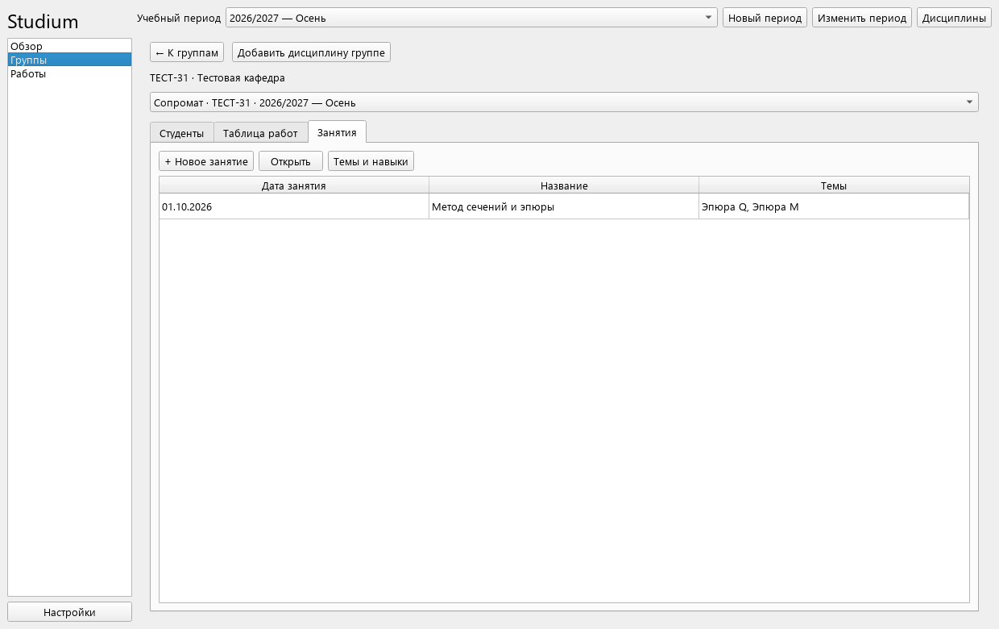

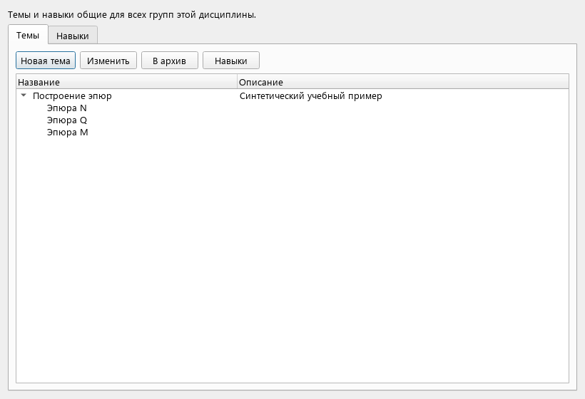

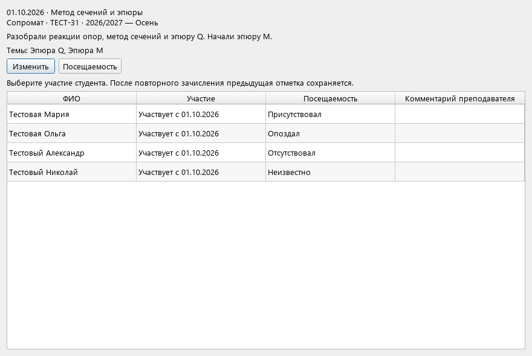

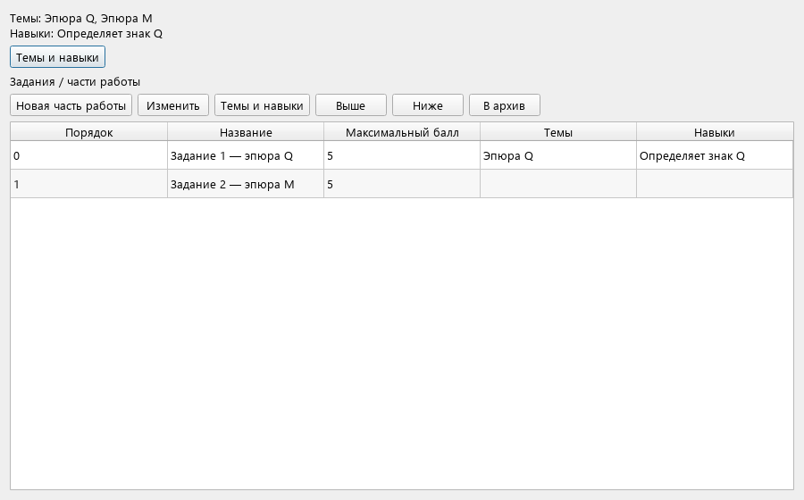

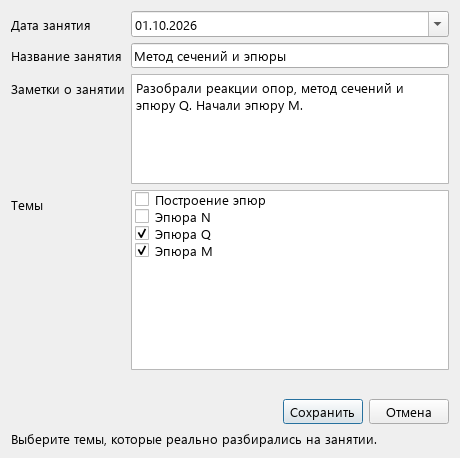

## Минимальные дополнения Phase 4

История StudentWork сохраняет таблицу прошлых Attempt и комментарий. Под ними — «Файлы · Попытка N» для выбранной строки. Первый Attempt выбирается при открытии; при переключении показывается собственный набор этой попытки. Новая попытка создаётся отдельно, прошлые файлы автоматически не копируются/не перемещаются.

«+ Добавить файл» — multi-select Windows file picker; локальные файлы можно перетащить в раздел. Сначала нужна сохранённая Attempt. Импорт каждого файла независим: ошибка одного показывает русское сообщение, предыдущие успешные импорты остаются. «Открыть» — controlled оригинал в default application Windows; «Просмотреть»/double-click — contextual dialog; «Убрать вложение» после confirmation soft-deletes link, physical original не удаляет. «Обновить / проверить» перечитывает список/целостность.

Карточка студента теперь имеет Обзор / Работы / **Файлы**. Третья вкладка объединяет Student → Work → Attempt → Attachments из всех его работ/периодов, а не только текущей дисциплины. Колонки: дата предъявления, работа, попытка, имя, MIME, состояние. Сортировка — новые предъявления сверху, страницы внутри попытки по sort_order; простой текстовый фильтр по строке. Это список истории, не document manager.

Preview показывает Student, Assessment, Attempt number/presented date, original filename, MIME/size/SHA-256. Images имеют переключатель «Вписать изображение в окно» и scroll для увеличенного bounded preview; thumbnail показывается у выбранной image row. PDF — имеющийся QtPDF (если модуль отсутствует, кнопка external open). Обычные документы/архивы — metadata и default app. BIN хранится только для учёта и системное открытие запрещено.

Состояния: «Доступен», «Файл отсутствует», «Файл повреждён». Missing/corrupt row остаётся с контекстом; view metadata доступен, open/preview original сообщает проблему и не использует старый cached thumbnail. Не заявляется автоматическое восстановление bytes/backup. Отдельные IO/permission/disk-full/decoder ошибки имеют русские сообщения и не завершают приложение. Приёмка DPI/клавиатурных рабочих сценариев остаётся пользовательской.

Синтетические снимки: `python scripts/preview_desktop.py --phase 4 --output docs/screenshots`. Все sources/DB/cache temporary, реальные данные не используются; исторические screenshots сохранены.

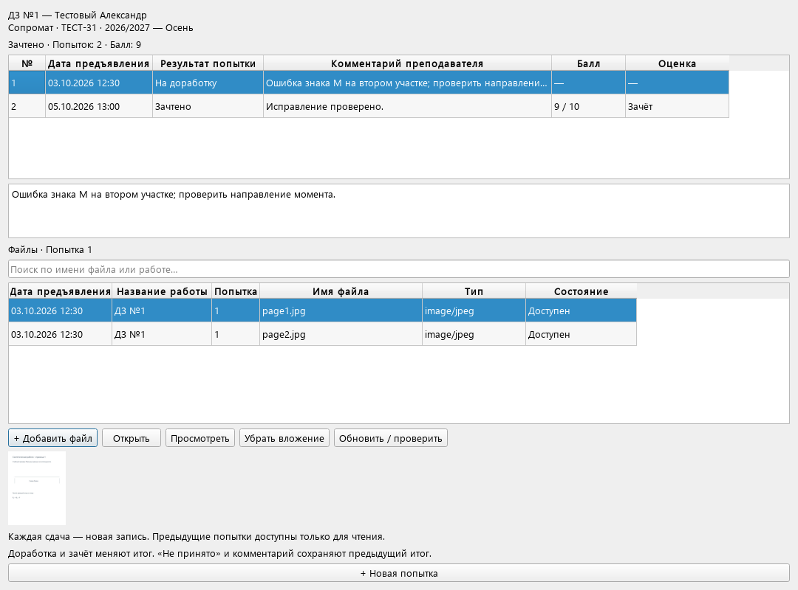

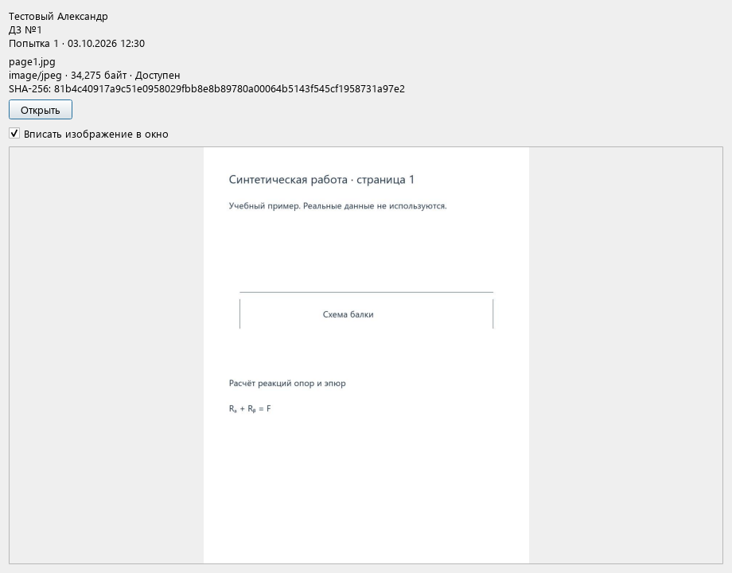

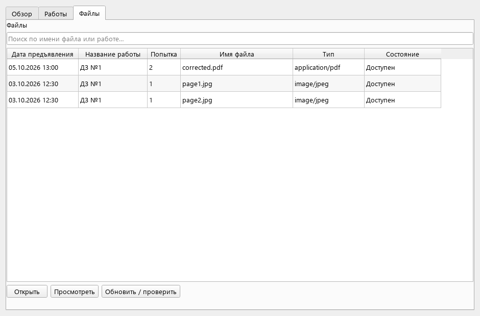

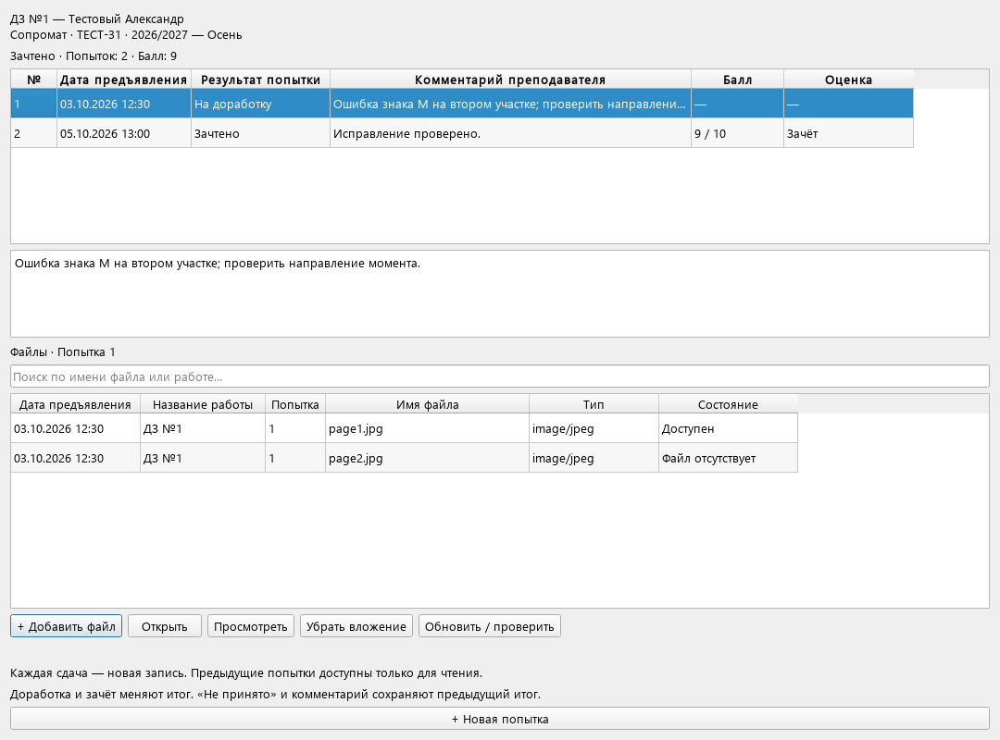

## Реализованная переписка Phase 5

Sidebar получил «Вопросы» после «Работы». Это вопросы **за все периоды**, глобальный term selector не скрывает историю другого семестра. Колонки: дата открытия, Student, группа/дисциплина offering, title/preview, канал последнего Message, derived состояние. «Все / Ожидает ответа / Ответ дан / Закрыт» фильтрует projection; поиск — по ФИО/title/body, включая многострочный Unicode текст. Раздел перечитывается при переходе и имеет кнопку обновления.

«Новый вопрос»: Student, optional discipline/group/period, title, Channel, локальная дата/время, многострочный body и кнопка «Вставить текст из буфера». Work/Attempt/Topics/Skills выбираются checklist вручную. Вариант «Общий вопрос» не получает educational links автоматически. Пустой body не сохраняется; первый Message и контекст commit атомарны.

Case dialogue показывает Student, offering с периодом, title/state, context table и transition к работе. В выборе Attempt указаны название Assessment/номер/дата, чтобы #1 разных работ не смешивались. Хронологическая таблица показывает роль/date/channel/text preview, STUDENT/TEACHER имеют разные подписи/цвета. Выбор строки открывает полный неизменённый body и её файлы. «+ Сообщение студента» / «+ Ответ преподавателя» добавляют факт; ответ сохраняется локально, ничего не отправляется.

«Закрыть вопрос» / «Открыть снова» работают с closed_at, сложного status workflow нет. Archive case скрывает его из списка без потери history/files. Message editing не предложено. История читается также после скрытия Student/Assessment; добавление нового факта проверяет active context. Transition к существующей истории работы read-only, сохраняет archived context; новой работе нужны штатные membership rules.

«+ Добавить файл» прикладывает несколько файлов **выбранному Message**. Импорт каждого независим; ошибка показывается, прежние успешные файлы остаются. Double-click/«Просмотреть» использует тот же FilePreviewDialog/image/PDF/metadata adapters Phase 4. Integrity/immutable bytes и detach semantics сохранены. Файлы Attempt не копируются в сообщения автоматически.

Student card теперь имеет Обзор / Работы / Файлы / **Вопросы**. Вопросы показывают дату/title/дисциплину/state/channel за все периоды данного Student. Double-click открывает case; новый вопрос сразу получает Student и текущий offering карточки. Вкладка файлов Phase 4 по-прежнему показывает файлы Attempt; Message files доступны в переписке.

Снимки содержат только synthetic data и temporary roots. Повтор: `python scripts/preview_desktop.py --phase 5 --output docs/screenshots`. Native checks не заменяют пользовательскую DPI/keyboard приёмку.

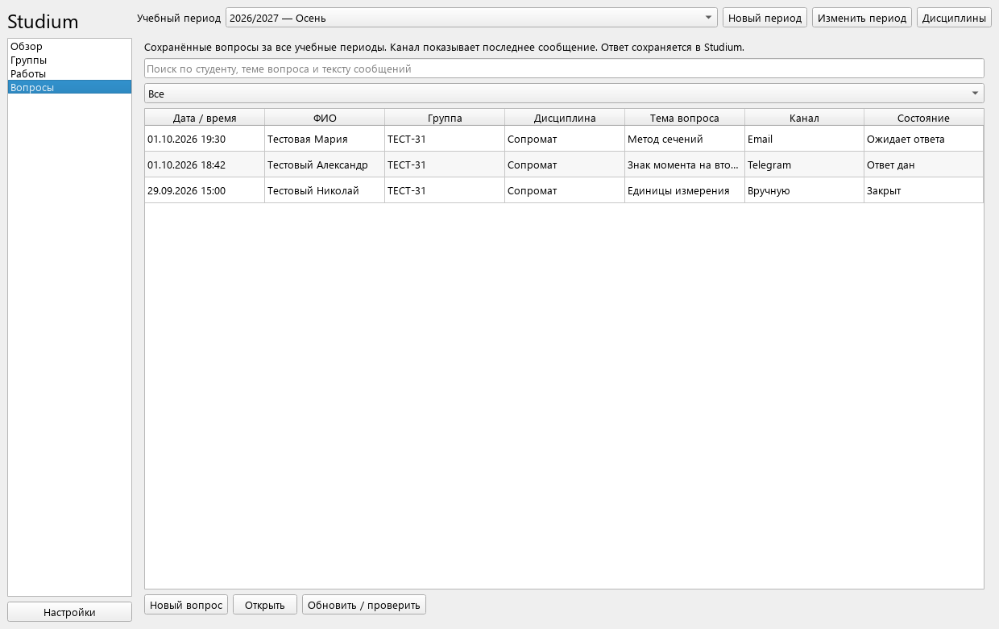

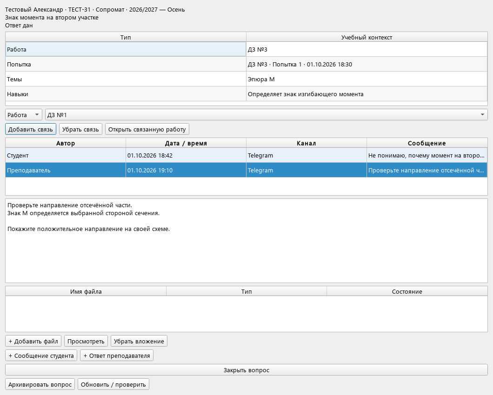

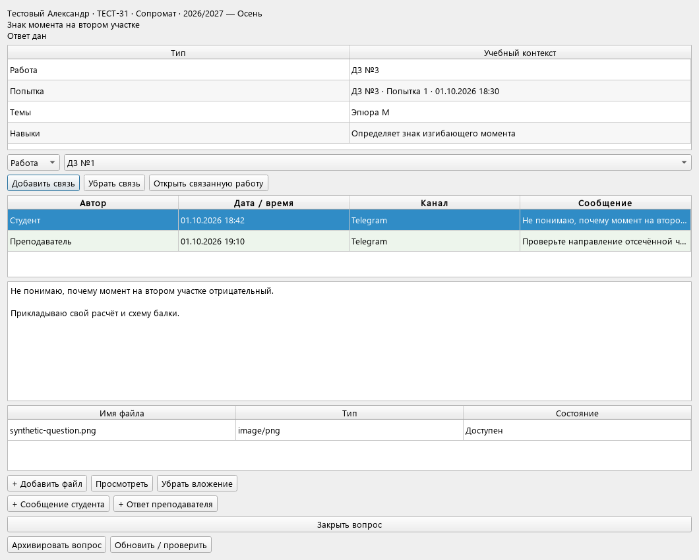

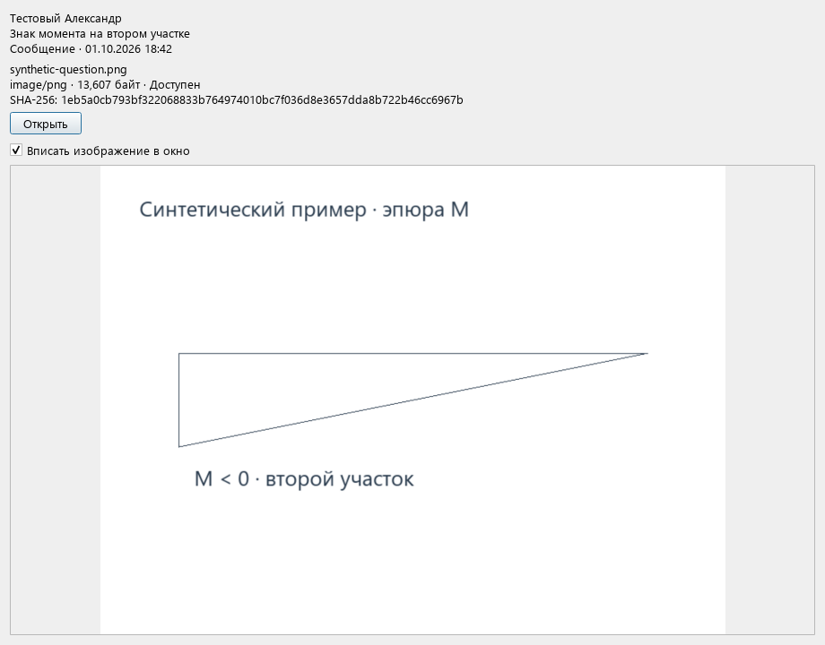

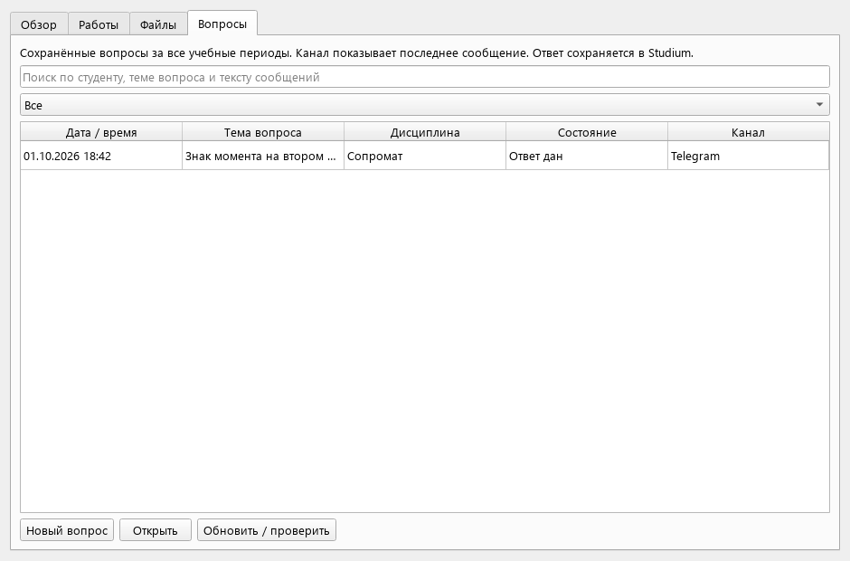

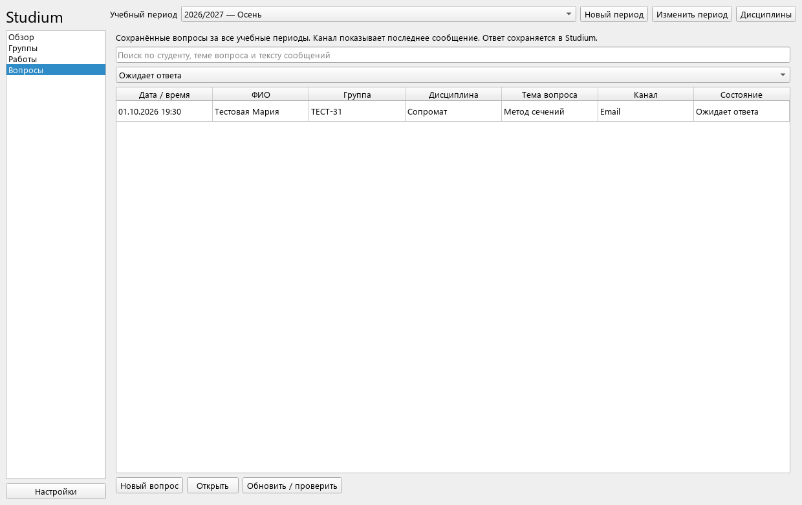

## Снимки Phase 2

Синтетические данные, temporary SQLite; offscreen QWidget.grab без установки компонентов. Для шрифтов только процесса preview загружены существующие Windows Segoe UI / Segoe UI Symbol. Снимки не содержат реальных студентов и не заменяют ручную Windows/DPI-приёмку. Повтор: `python scripts/preview_desktop.py --output docs/screenshots`.

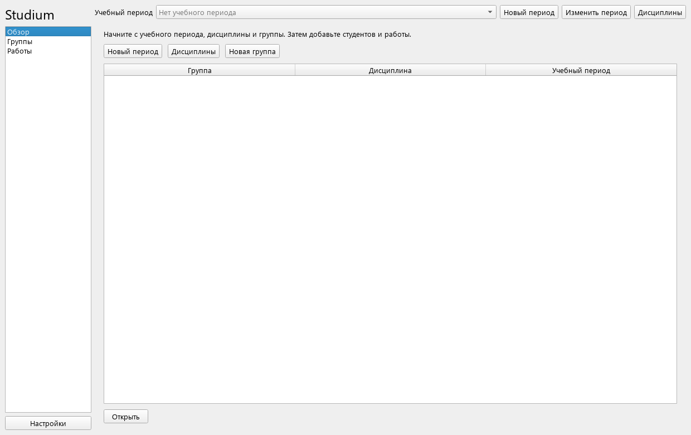

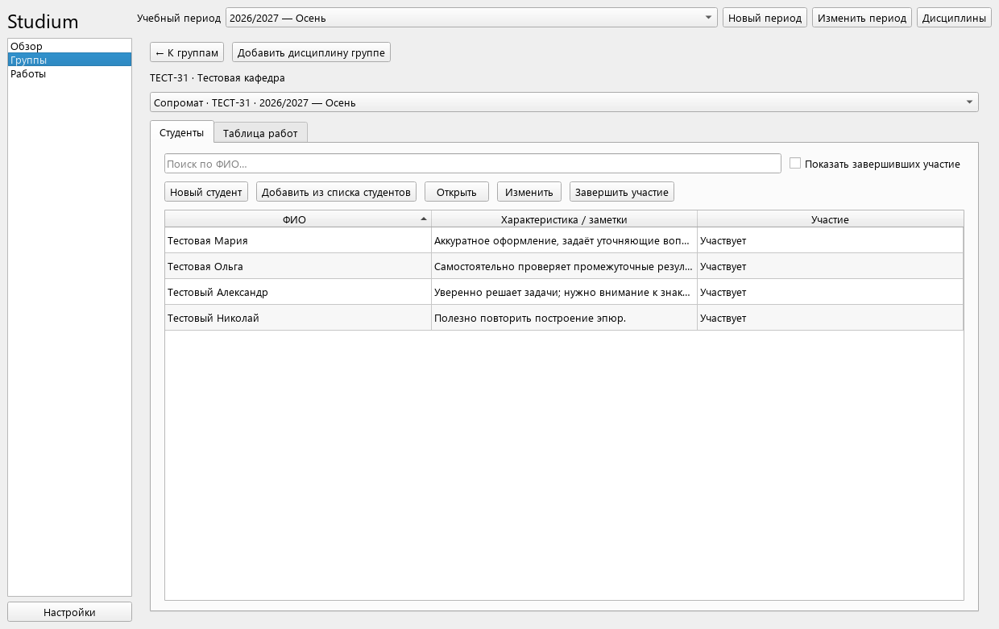

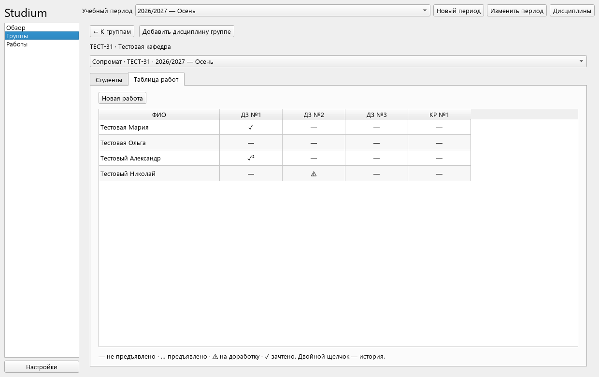

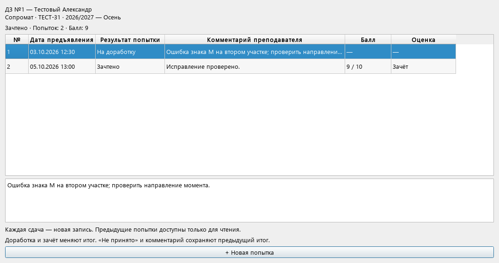

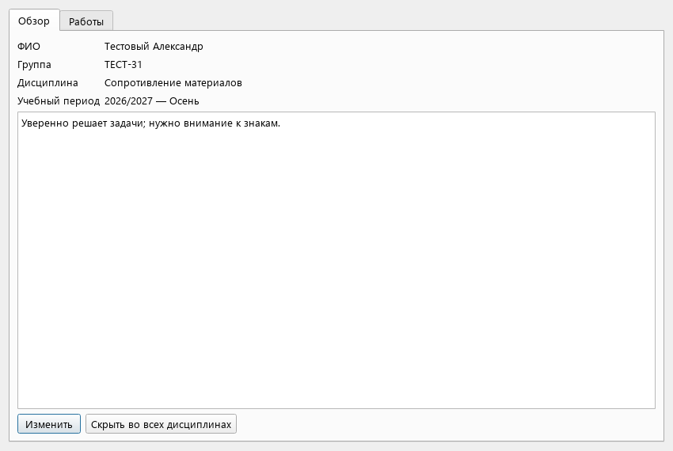

## Минимальные дополнения Phase 6

Student card сохраняет Обзор / Работы / Файлы / Вопросы и добавляет пятую вкладку **Прогресс**. Она показывает выполнено X из Y, начатые работы/попытки, первую сдачу, среднее число попыток, своевременные/поздние/не сданные в срок работы, доступный нормированный балл, посещаемость и вопросы/ответы. Внутри доступна таблица Topic/Skill facts; процента освоения и оценки «сильный/слабый» нет.

Группа → выбранная дисциплина → четвёртая вкладка **Аналитика**: число текущих студентов, completion distribution без имён/рейтинга, средняя доля выполненных работ, попытки/first-pass/timeliness/attendance/questions. Student/Group comparison позволяет выбрать прежний точный момент и перечитать показатели рядом с текущими. Подпись объясняет cutoff известных фактов и отсутствие полного audit snapshot.

Работа → список студентов имеет вкладку **Результаты**: назначено/начали/не начинали, в процессе/доработка/зачтено, attempts/first-pass, срок, среднее/медиана балла при наличии данных и таблица результатов частей. Статусы использует существующая domain projection. Открытие этих разделов не создаёт StudentWork и не изменяет факты.

История → выбрать сохранённую Attempt → **Результаты частей** доступна, если у Assessment есть Items. Выбрать часть → записать outcome и/или score/max_score, optional comment. Outcome необязателен при score, score необязателен при outcome; новая строка относится именно к выбранной попытке. Уже записанные facts read-only; для новой переделки создаётся новая Attempt. У работы без Items обычный workflow сохраняется.

Переход из «Вопросов» к истории архивированной Assessment/Course/Offering сохраняет прежние Items/results. Historical query явно opt-in; архивный контекст полностью read-only, даже если какая-то часть ещё не оценена. Проверено для Assessment- и Attempt-links без INSERT/UPDATE/DELETE.

Дисциплины → Темы и навыки → выбранная Topic/Skill → **Факты**: число покрывающих работ/частей, distinct evidence, students, оценённые Items, CORRECT/PARTIAL/INCORRECT, нормированный item score и связанные вопросы. Можно выбрать offering либо все контексты дисциплины; Topic имеет переключатель descendants с distinct aggregation. Занятия/Attendance показываются только для Topic; LessonSkill не угадывается из TopicSkill (OPEN-004).

None/пустой знаменатель отображается «Нет данных», отсутствие применимого срока/прямого вида связи — «Не применимо». Score 0 с известным maximum остаётся 0%. После первой Attempt форма содержания сообщает semantic lock: смысл/состав/теги/максимумы нельзя изменить; расписание и presentation order — отдельные разрешённые действия. Формулы и ограничения — [analytics.md](analytics.md).

Шесть synthetic screenshots Phase 6 сохранены и визуально проверены. Воспроизведение: `python scripts/preview_desktop.py --phase 6 --output docs/screenshots`; native temporary workflow — `python scripts/smoke_analytics.py`. Рабочие данные/реальные студенты для снимков и проверок не используются; отдельная пользовательская DPI/keyboard приёмка не заявляется автоматической.

- [Student Progress](screenshots/phase6-student-progress.png)
- [Group Analytics](screenshots/phase6-group-analytics.png)
- [Assessment Results](screenshots/phase6-assessment-analytics.png)
- [Attempt Item Results](screenshots/phase6-attempt-item-results.png)
- [Topic Evidence](screenshots/phase6-topic-evidence.png)
- [Skill Evidence](screenshots/phase6-skill-evidence.png)

## Целевая карта следующих фаз

Историческая схема ниже описывает полный продукт; она не является списком активных разделов Phase 2.

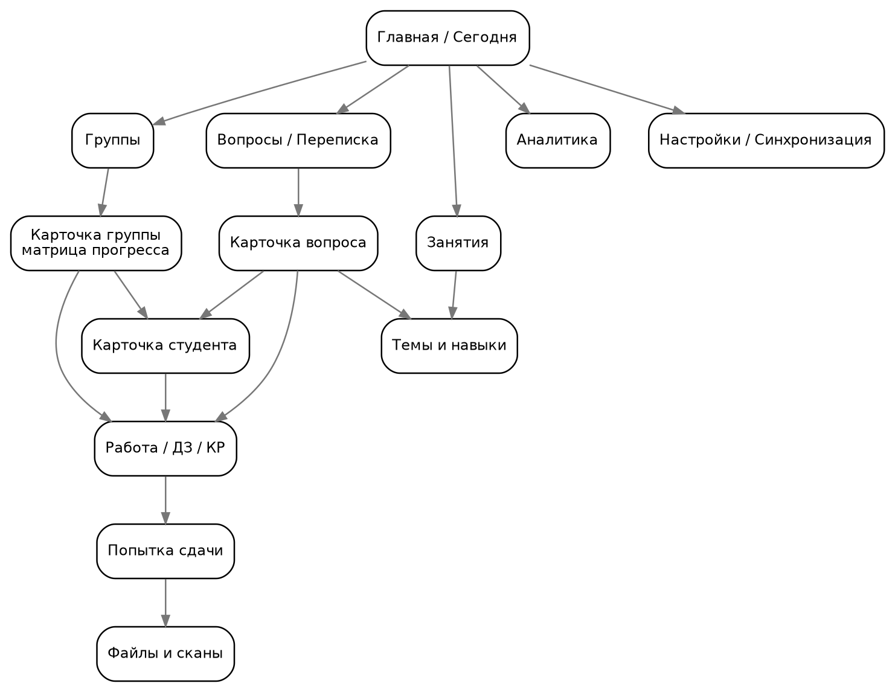

## Экраны

| Экран | Содержание и переходы | Основная фаза |
|---|---|---|
| Главная / Сегодня | Ближайшие занятия, группы сегодня, ожидающие/просроченные работы, открытые вопросы, быстрые действия; переходы к группам, занятиям, Inbox, аналитике, настройкам | основа 2, расширение 3–10 |
| Группы | Активные потоки по семестру, фильтры и архив → карточка группы | 2 |
| Карточка группы/потока | Матрица работ, студенты, занятия, темы, вопросы, аналитика; контекст CourseOffering сохраняется в переходах | 2–10 |
| Матрица прогресса | Строки — студенты, столбцы — Assessment; статус цветом/иконкой, число попыток; ячейка → работа студента/новая попытка | 2 |
| Карточка студента | Обзор, лента, работы, темы/навыки, вопросы, файлы, заметки, аналитика | основа 2, расширение 3–10 |
| Карточка работы | Описание, темы/навыки, студенты и статусы, общая статистика → StudentWork/Attempt | 2–3, расширение 6 |
| Попытка | Дата, результат, балл, замечания, результаты элементов; просмотр прежних попыток, новая сдача отдельной записью | 2, файлы 4 |
| Занятие | Посещаемость, темы/coverage, конспект, выданные работы, файлы → темы/работы | 3–4 |
| Вопросы / Inbox | Фильтры по студенту, потоку, теме, статусу, каналу → карточка вопроса | 5 |
| Карточка вопроса | Исходный вопрос, сообщения и ответ, вложения, Student/Assessment/Topic/Skill и другие требуемые связи, teacher verification | 5, AI-предложения 10 |
| Темы и навыки | Дерево курса, пройденные темы; позднее статистика покрытия и проблем | 3, аналитика 6 |
| Аналитика | Студент, группа/поток, тема, работа, вопросы; объяснимые агрегаты из фактов | 6; согласованный объём ADR-031/032, OPEN-012 RESOLVED |
| Настройки | Хранилище, резервные копии, справочники; позже синхронизация и интеграции | по соответствующим фазам |

Вкладки будущих функций вводятся вместе с реализацией. Карта не означает, что весь список нужно создавать в первом Windows shell. UI использует русские подписи, а названия доменных сущностей остаются согласованными с ТЗ.

## Карточка студента

По §9.2: «Обзор» показывает задолженность, последние события и общий прогресс; «Лента» — хронологию попыток, оценок, вопросов, заметок и занятий; «Работы» — ДЗ/КР/экзамены; «Темы» — освоенность, ошибки и вопросы; «Вопросы» — переписку/Q&A; «Файлы» — галерею сканов/фото; «Заметки» — наблюдения преподавателя; «Аналитика» — динамику и объяснимые агрегаты. Общая заметка Student и датированные StudentNote не заменяют историю сообщений.

## Сдача на семинаре

Главная → группа/поток → матрица → ячейка «студент / ДЗ» → «Новая попытка» → NEEDS_REVISION → короткое замечание → фото/файл → сохранить → вернуться к матрице.

После открытия ячейки целевой ориентир — 3–5 действий для типичной сдачи без детализации по задачам. Выбор результата Attempt не скрывает прежнюю историю. Следующая переделка создаёт новый номер попытки. Windows использует выбор файла; камера и платформенная галерея уточняются в Android-фазе.

## Ручное добавление вопроса

«Добавить вопрос» → выбрать канал → вставить исходный текст и указать дату/студента, если известен → приложить файл → связать с работой, темами/навыками и учебным контекстом → сохранить ответ или связать исходящее сообщение.

Для реализованной Phase 5 состояние определяется closed_at и последним активным author (ADR-027; OPEN-003 RESOLVED). Исходные workflow статусы ТЗ не сохранены как отдельный source of truth. Ручной ввод не требует доступа к аккаунту Telegram/email и не отправляет ответ автоматически. Будущие AI-связи преподаватель подтверждает отдельно.

## Сквозная проверка истории

Сценарий README: попытка #1 NEEDS_REVISION с фото → вопрос Telegram/email и ответ со связью с ДЗ/Topic → попытка #2 ACCEPTED → в карточке студента доступны оба предъявления и переписка; матрица показывает итог и число попыток. Для приёмки §18 используются две переделки и третья зачтённая попытка, три изображения у каждой, сохранность после перезапуска.

На этапе UI отдельно проверить: контекст потока в переходах, быстрый возврат к матрице, локальное сохранение без сети, доступность сохранённых файлов, порядок истории, различимость статуса и количества попыток. Числовой SLA и детали клавиатурной/адаптивной навигации выбираются при проектировании Windows/Android UX, не объявляются выполненными в Phase 0.
